# lucasFireC2F User Guide

For lucasFireC2F 2.4.0. Exported 16 October 2026 from the working copy of the guide.

## About this guide

This guide builds, calibrates and runs a lucasFireC2F burn-probability model for one fire zone entirely from SyncroSim Studio, with no scripts. The worked example is Pyrome 18, Southern Cascades, built in its own library, lucasFireC2F-Demo, and in chapter 8 merged with two neighbouring pyromes from another library.

It is for modelers who know SyncroSim's basics (libraries, projects, scenarios, results) but not this package. The science behind each stage is in the lucasFireC2F methods paper; this guide covers what to click, what to enter and what to check.

**Conventions**

- **Screen captures.** Each step that changes a setting shows the Studio window with the field outlined. Captures are taken from Studio 3.1 on Windows.
- **Scenario descriptions.** Every scenario gets a written description (Properties, Description) recording its purpose, dependencies, key settings and assumptions. Chapter 9 gives a template per scenario type; chapters 3 to 5 show the P18 versions.
- **Names and folders.** A single-zone library needs no folders; a library holding several zones uses one folder per zone (Chapter 8). Scenarios are named `<zone> - <step>`, with the zone's full name, for example `P18 Southern Cascades - Prep`, `P18 Southern Cascades - Calibrate`, `P18 Southern Cascades - Run`. SyncroSim names results after their parent with a run time stamp.
- **Result IDs.** Dependencies point at results, not at the scenarios that made them. Write down each result's ID as you go; later steps ask for them.
- **Package version.** Written for lucasFireC2F 2.3.0 on SyncroSim 3.1.

**The workflow in one line.** Prep (P1-P5) → Calibrate (C1-C3, seed run, C5) → Run (stages 1-8, C6, C7, optionally R) → optionally Merge (stage M) with neighbouring zones.

## 1. Install and library setup

A lucasFireC2F model lives in a SyncroSim library (`.ssim` file) that uses the lucasFireC2F package. This chapter creates that library.

**Before you start**

- SyncroSim Studio 3.1 or later, installed in `C:\Program Files\SyncroSim`.
- R 4.6 with the packages rsyncrosim, terra, sf, data.table, arrow, mgcv and jsonlite. SyncroSim runs every stage in R.
- The lucasFireC2F package installed (section 1.1).
- The national data on a local drive (Chapter 2 lists each file).

### 1.1 Install the package

SyncroSim keeps one list of installed packages for the whole computer. A package is installed once, then added to each library that uses it (1.5). Check the list first, from the **File** menu:

1. Open the **File** menu.
2. Click **Local Packages**. The Local Packages tab lists every installed package and its version.
3. If **lucasFireC2F** is listed with the version you want (2.3.0 here), go on to 1.2.

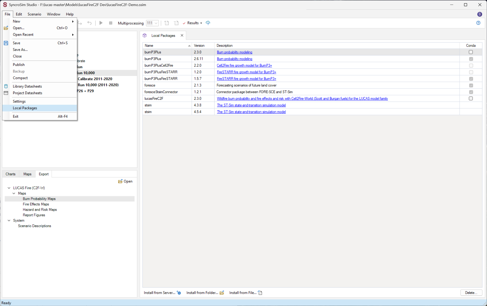

Otherwise install it with one of the buttons along the bottom of the tab:

- **Install from File...** installs a release file, `lucasFireC2F-<version>.ssimpkg`, from the repository's Releases page. SyncroSim copies the package into its own package folder, so the downloaded file can be deleted afterwards.
- **Install from Folder...** installs a copy of the repository, https://github.com/bsleeter/lucasFireC2F, cloned with git or downloaded with *Code, Download ZIP* and unzipped. SyncroSim runs the package from that folder rather than copying it, so leave the folder where it is. Changes pulled into it take effect the next time a scenario runs.

**Install from Server...** lists the packages in SyncroSim's online repository; lucasFireC2F is not published there. The repository's README gives the same two routes from the command line, and how to move a library to a new version.

> **Several versions side by side.** SyncroSim can hold several versions of a package at once (the screenshot has two of burnP3Plus and of stsim), and each library uses the version it was given. Installing a new version of lucasFireC2F does not change existing libraries until they are upgraded.

### 1.2 Open SyncroSim Studio

Start SyncroSim Studio. If a library opened last time, it appears in the Explorer on the left; that does not matter here.

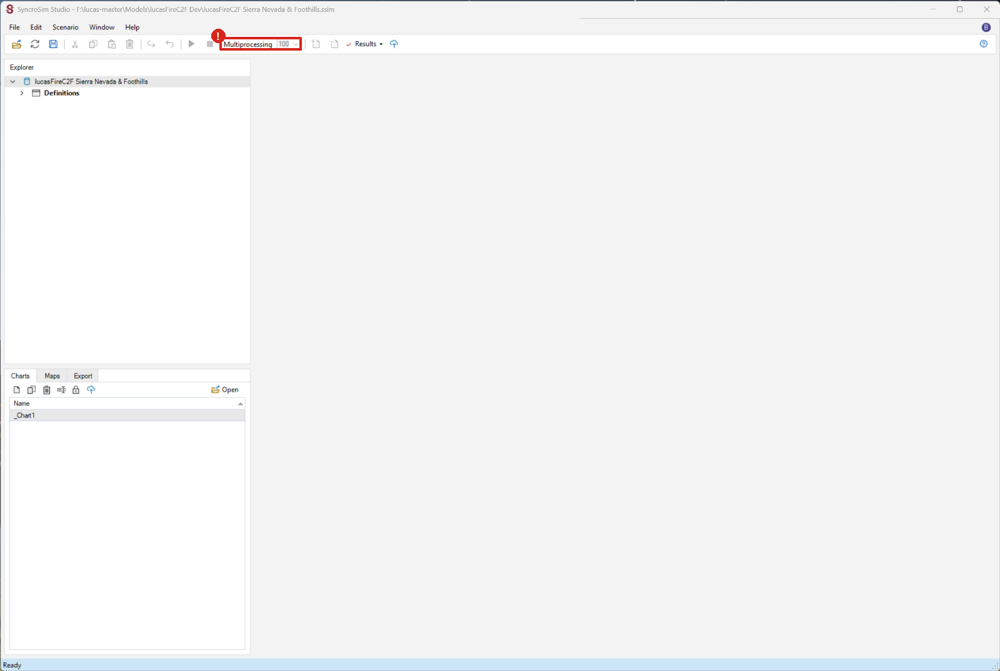

> **Turn Multiprocessing off.** lucasFireC2F parallelises fire growth itself, across all cores but one. SyncroSim's own Multiprocessing splits a scenario into separate jobs, which this package cannot use; a run started with it on stops at once with a message saying so. The toolbar box (outlined) only shows the maximum number of jobs; whether multiprocessing is on is set in the library's System tab (step 1.7).

### 1.3 Create an empty library

1. Open the **File** menu.
2. Point to **New**.
3. Click **Empty Library...**.

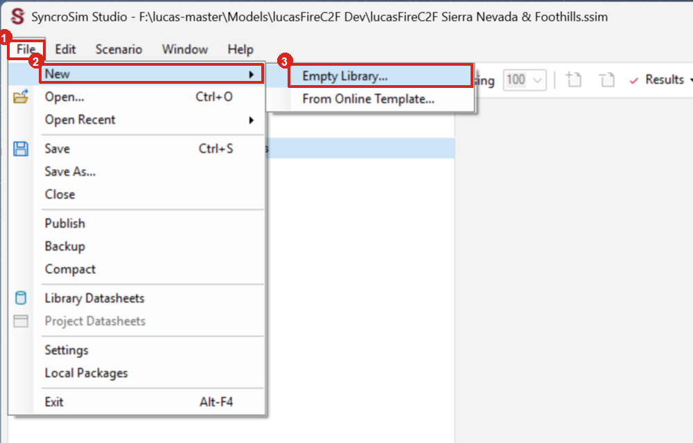

### 1.4 Name and save the library

Studio asks where to save the new library. This guide uses `lucasFireC2F-Demo.ssim`. SyncroSim writes the library file plus two folders beside it, `lucasFireC2F-Demo.ssim.data` (every map and table the runs produce, several GB per zone) and `lucasFireC2F-Demo.ssim.temp`, so pick a drive with room.

The new library opens with one project, **Definitions**, and one empty scenario, **\[1\] New Scenario**.

### 1.5 Add the lucasFireC2F package

A new library has no packages. Add lucasFireC2F from the library's properties.

1. Double-click the library name in the Explorer to open its properties.
2. Select the **General** tab.
3. Select **Packages**. The list is empty.
4. Click **Add...**.

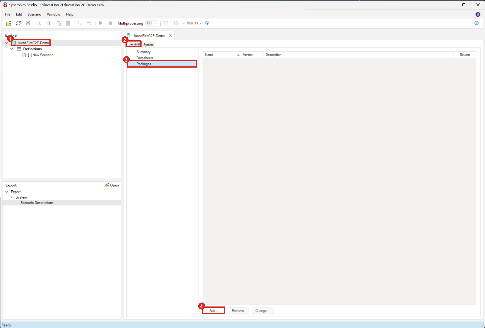

The Add Package dialog lists every package SyncroSim can see: installed ones (page or folder icon under Source) and ones it can download from the online repository (globe icon).

5. Tick **lucasFireC2F** and check its version (1.9.1 in this screenshot; 2.3.0 at the time of writing). A folder icon under Source means it is installed from a folder on disk.
6. Click **OK**.

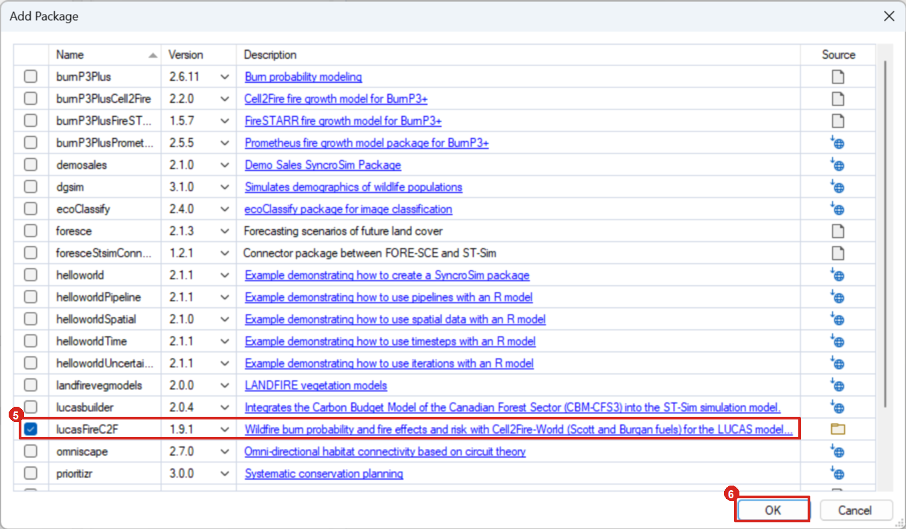

### 1.6 Check the package

The Packages list now shows lucasFireC2F with its version. Leave **Conda** unticked: lucasFireC2F uses the R installation SyncroSim finds, not a Conda environment.

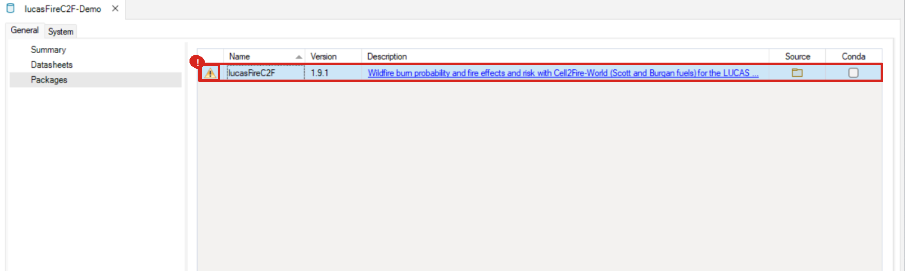

> **The warning icon.** A package installed from a folder shows a warning triangle: SyncroSim reports it was "built for an undetermined version of SyncroSim". It does not affect runs and can be ignored.

Save the library (File, Save, or Ctrl+S) after adding the package. Studio then loads the package's datasheets, and the project and scenario gain the lucasFireC2F properties used from Chapter 2 on.

### 1.7 Library system settings

Two library settings matter for lucasFireC2F: multiprocessing must be off, and SyncroSim must find the R installation that has the required packages. Both are on the library properties' **System** tab.

**Multiprocessing off**

1. In the library properties, select the **System** tab.
2. Under **Multiprocessing**, select **General**.
3. Make sure **Enable multiprocessing** is unticked. The other options grey out, and the maximum number of jobs no longer matters.

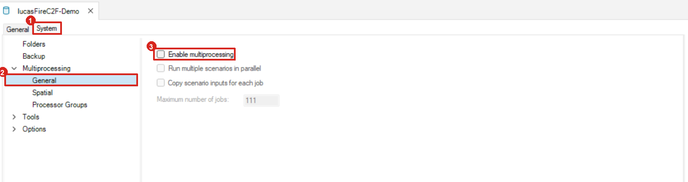

**R installation**

1. Still on the **System** tab, expand **Tools** and select **R**.
2. Choose **Run directly** and check that **R executable** points to the `Rscript.exe` of the R that has the packages listed under Before you start (here `C:\Program Files\R\R-4.6.1\bin\Rscript.exe`). Use **Browse...** if it points elsewhere; **Default** restores SyncroSim's guess.

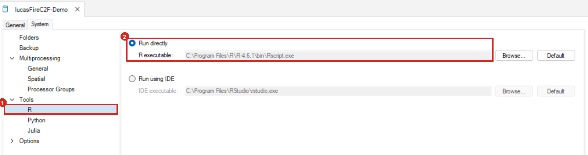

> If several R versions are installed, SyncroSim may pick one without the packages. A stage then fails at its first line with "there is no package called ...". Point **R executable** at the right `Rscript.exe` and run again.

Save the library.

### 1.8 Rename and describe the project

A library holds one or more projects; everything lucasFireC2F shares between scenarios (Data Sources, Fire and Weather Zones, fuel tables) is project data. Give the default project a real name and a description.

1. Double-click **Definitions** in the Explorer to open the project properties.
2. Select the **General** tab, then **Summary**.
3. Type the project name in **Name**. This guide uses `My Fire Project`.
4. Write a short **Description**: what the project models, the package version, and where its data come from.

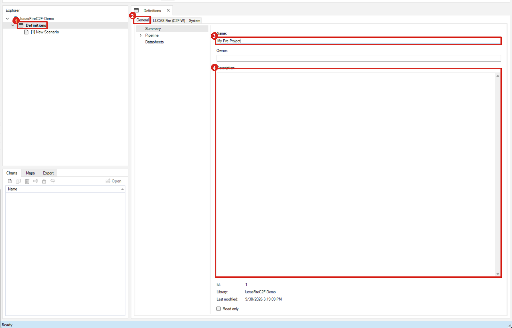

Example description:

```markdown
lucasFireC2F demonstration project: Pyrome 18, Southern Cascades, built entirely in SyncroSim Studio following the lucasFireC2F User Guide.
Package: lucasFireC2F 2.3.0 on SyncroSim 3.1.
Project data (Data Sources, Fire Zones, Weather Zones, Fuel Types and Models, Vegetation Classes) apply to every scenario here; national inputs are LANDFIRE 2020 at 150 m, FPA-FOD 1992-2020, MTBS, gridMET zone weather and FEMS RAWS.
```

The project properties also have a **LUCAS Fire (C2F-W)** tab: the package's project datasheets, filled in Chapter 2.

Save the library.

> **Folders.** This library models one zone, so its scenarios sit directly under the project. A library that holds several zones (for example, several pyromes to be merged with stage M) keeps each zone's scenarios in their own folder: right-click the project, **New Folder**, name it after the zone. Chapter 8 covers that layout.

### 1.9 The stage list

The project properties' **General, Pipeline** page lists every stage the package defines: 22 in all since version 2.3.0 added **R - Report Figures (optional)** (the screenshot, taken earlier, shows 21). They are sorted by internal name (Stage Name) with the name you see in pipelines beside it (Stage Description). It is a catalog, not a run order, and it cannot be edited. Each scenario picks its own stages and their order in its own **Pipeline** sheet; a new scenario's pipeline is empty, and nothing runs until you fill it.

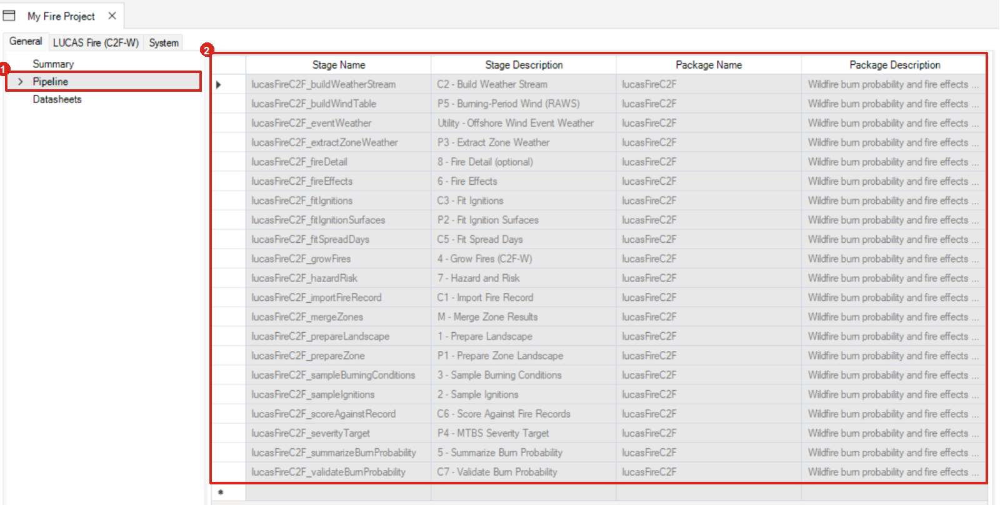

One of them, **Utility - Offshore Wind Event Weather**, is an optional tool for adding observed offshore-wind (Diablo, Santa Ana) days to a weather stream; a standard zone build does not use it.

A zone is built with three scenarios, each running its own part of the catalog:

| Scenario | Stages, in run order | Depends on |
| --- | --- | --- |
| Prep | P1 Prepare Zone Landscape, P2 Fit Ignition Surfaces, P3 Extract Zone Weather, P4 MTBS Severity Target, P5 Burning-Period Wind (RAWS) | nothing |
| Calibrate | C1 Import Fire Record, C2 Build Weather Stream, C3 Fit Ignitions, 1 Prepare Landscape, 2 Sample Ignitions, 3 Sample Burning Conditions, 4 Grow Fires (C2F-W), 5 Summarize Burn Probability, C5 Fit Spread Days | the Prep result |
| Run | 1 Prepare Landscape, 2 Sample Ignitions, 3 Sample Burning Conditions, 4 Grow Fires (C2F-W), 5 Summarize Burn Probability, 6 Fire Effects, 7 Hazard and Risk, 8 Fire Detail (optional), C6 Score Against Fire Records, C7 Validate Burn Probability, R Report Figures (optional) | the Calibrate result, then the Prep result |

In Calibrate, stages 1-5 are the seed run: fires grown for 1 to 25 days at random so C5 can fit the spread-day distribution. Run repeats stages 1-5 with the fitted distribution, then adds effects, risk and scoring. A library with several zones adds a fourth type, Merge (stage M, then 5-8; Chapter 8). Chapters 3 to 5 build each scenario in turn.

The library is ready: lucasFireC2F added, multiprocessing off, R set, project named. Chapter 2 fills the project data.

## 2. Project data

Project data are shared by every scenario in the project. They sit on the project properties' **LUCAS Fire (C2F-W)** tab: fuels, zones and categories, effects and risk tables, and the paths to the national data on disk.

### 2.1 The input data

The 22 Data Sources rows point at 17 published datasets, all of them national, so the same rows serve any pyrome in the conterminous US. The prep stages build each zone's inputs from these files (grids, zone weather, ignition covariates, the wind table) when the zone is prepared; nothing has to be pre-processed by hand. This section lists what each dataset is, which products and files are used, and where to download them. Links were checked on 30 Sep 2026.

#### Published datasets

| Dataset | Publisher | Version used | Used for | Download |
| --- | --- | --- | --- | --- |
| LANDFIRE 2020 (LF 2.2.0) | USGS / USDA Forest Service | LF 2020 Update, 2.2.0 | Fuels and canopy (P1), fuel term of the ignition fit (P2), severity target (P4), elevation | [LF 2020 page](https://www.landfire.gov/data/lf2020); archive at [ScienceBase](https://doi.org/10.5066/P1LJEZ3G) |
| LANDFIRE Biophysical Settings (BpS) | USGS / USDA Forest Service | LF 2020 | Origin-vegetation strata (P1) | [LF2020\_BPS\_CONUS.zip](https://landfire.gov/data-downloads/CONUS_LF2020/LF2020_BPS_CONUS.zip) |
| FPA-FOD, Spatial wildfire occurrence data for the United States, 1992-2020 | USDA Forest Service Research Data Archive | 6th edition, FPA\_FOD\_20221014 (GeoPackage) | Ignition surfaces (P2), fire record for calibration (C1) | [RDS-2013-0009.6](https://doi.org/10.2737/RDS-2013-0009.6) |
| MTBS Burned Area Boundaries | MTBS program (USGS / USDA Forest Service) | August 2026 release, 1984-2026 | Validation (C7); fire-activity weights of the zone weather | [MTBS direct download](https://www.mtbs.gov/direct-download) (now on the USGS Burn Severity Portal); also the [FS Geodata Clearinghouse](https://data.fs.usda.gov/geodata/edw/datasets.php?xmlKeyword=monitoring+trends+in+burn+severity) |
| MTBS annual burn severity mosaics (CONUS) | MTBS program | mtbs\_CONUS\_1984 to 2024 | Severity target (P4); fire-age grid | [MTBS direct download](https://www.mtbs.gov/direct-download), files `mtbs_CONUS_<year>.zip` |
| Wildfire Risk to Communities (WRC), 2nd edition | USDA Forest Service | RDS-2020-0016-2 (2024) | Burn probability benchmark (C7) | [RDS-2020-0016-2](https://doi.org/10.2737/RDS-2020-0016-2); [wildfirerisk.org](https://wildfirerisk.org/download/) |
| Pyromes of the conterminous United States | USDA Forest Service Research Data Archive | RDS-2020-0020 (2020) | Fire zones (P1 rasterises them) | [RDS-2020-0020](https://doi.org/10.2737/RDS-2020-0020) |
| NWS Fire Weather Zones | NOAA National Weather Service | fz03mr26 | Weather zones (P1); RAWS station time zones (P5) | [weather.gov/gis/FireZones](https://www.weather.gov/gis/FireZones) |
| gridMET daily meteorology | Climatology Lab (Abatzoglou 2013) | 4 km, 1979-2024 | Zone daily weather (P3); warm-season rain covariates | [climatologylab.org/gridmet](https://www.climatologylab.org/gridmet.html); files at [northwestknowledge.net/metdata/data](https://www.northwestknowledge.net/metdata/data/) |
| RAWS hourly observations (FEMS) | USDA Forest Service | 2006-2024, hourly | Burning-period wind table (P5) | [FEMS](https://www.wildfire.gov/application/fems); P5 downloads missing station-years itself |
| PRISM 30-year normals | PRISM Group, Oregon State University | 1991-2020, 4 km (M4) | Precipitation covariate (P2) | [prism.oregonstate.edu/normals](https://prism.oregonstate.edu/normals/) |
| Annual NLCD | USGS / MRLC | Collection 1, 2010 land cover | Development covariates (P2) | [mrlc.gov/data](https://www.mrlc.gov/data) |
| SILVIS wildland-urban interface | University of Wisconsin SILVIS Lab | Version 4, 1990-2020 change: 2010 housing density (HUDEN2010) on 2020 blocks; file geodatabase, 5 GB zip | Housing-density covariate (P2) | [SILVIS WUI](https://silvis.forest.wisc.edu/data/wui-change/); archive [RDS-2015-0012-4](https://www.fs.usda.gov/rds/archive/catalog/RDS-2015-0012-4) |
| LANDFIRE Roads | USGS / USDA Forest Service | LF 2023, 30 m (LF2023\_Roads\_CONUS) | Road-distance covariate (P2) | [landfire.gov Full Extent Downloads](https://www.landfire.gov/data/FullExtentDownloads) (Fuel section) |
| Interagency Fire Perimeter History | National Interagency Fire Center (NIFC) | All Years View (shapefile) | Fires too small for MTBS in the fire-age grid (P1) | [NIFC Open Data](https://data-nifc.opendata.arcgis.com), search InterAgencyFirePerimeterHistory |

The elevation row takes the LANDFIRE 30 m DEM (LF 2020 Elevation, `LC20_Elev_220.tif`), offered on the same LANDFIRE pages. GOES-West lightning flashes are not in the table: the lightning-density covariates were tested but are not used by P2.

#### LANDFIRE products

The single **LANDFIRE Folder** row points at a folder that must hold one unzipped folder per product, named as LANDFIRE ships them: `LF2020_<product>_CONUS...\LF2020_<product>_CONUS\Tif\LF2020_<product>_CONUS.tif` (a date-stamped folder name such as `LF2020_FBFM40_CONUS_20260522` also works).

| Product | LANDFIRE name | Read by | How it is used |
| --- | --- | --- | --- |
| FBFM40 | 40 Scott and Burgan Fire Behavior Fuel Models | P1, P2, P4 | The fuel map: modal value of the 25 cells in each 150 m cell (P1); fuel-group term in the ignition fit (P2); fuel groups of the severity target (P4) |
| CBD | Forest Canopy Bulk Density | P1 | A 150 m cell is forest when at least half its 30 m cells have CBD above 0; then the mean of the non-zero cells |
| CBH | Forest Canopy Base Height | P1 | Mean of non-zero cells |
| CC | Forest Canopy Cover | P1 | Mean of all cells |
| CH | Forest Canopy Height | P1 | Mean of non-zero cells; can come from another vintage (Zone Preparation Options, Canopy Height Vintage) |

The elevation grid and BpS are separate rows. LANDFIRE's Existing Vegetation Type, disturbance and FBFM13 are not read by the package.

> **LANDFIRE 2020 is archived.** landfire.gov's Full Extent Downloads page still offers LF 2020 BpS and elevation, but FBFM40, CBH, CBD, CC and CH for 2020 are now only in the USGS ScienceBase archive ([doi:10.5066/P1LJEZ3G](https://doi.org/10.5066/P1LJEZ3G)). Unzip every product after downloading: a product left as a zip file is not found. Keep LANDFIRE's folder and file names as they are. Some re-released packages keep an older file name inside the new folder (LF 2020 CH ships as \`Tif\\LC22\_CH\_220.tif\`); the prep stages then take the product folder's single GeoTIFF and say so in the run log.

#### What the prep stages build from them

Each zone's derived inputs are built by the prep stages and kept with the scenario's results; the run log says what was built and from which file. Four rows are optional shortcuts: Fire Zone Grid, Weather Zone Grid, Fire-Age Classes and Zone-Daily Weather Table (plus the Ignition Covariate Folder). Left blank, the stage builds that input; filled, it reads a prebuilt file instead. Statewide prebuilt versions for California are in `F:\lucasFireC2F\Data`. They were made with the same methods from slightly older releases (the 2010 SILVIS blocks, an earlier MTBS release), so they reproduce the published California models exactly. This guide leaves the shortcuts blank, as you would anywhere outside California.

| Built input | Stage | From | How |
| --- | --- | --- | --- |
| Model grid and elevation | P1 | LANDFIRE 30 m DEM | 150 m cells on one fixed national lattice: each is a 5 x 5 block of 30 m cells, elevation its mean truncated to the metre. Every zone lines up with every other, so zones merge cell for cell |
| Fire-zone grid | P1 | Pyrome shapefile | Rasterised at cell centres, then edge cells by touch; zone code = 1000 + pyrome number |
| Weather-zone grid | P1 | NWS fire weather zones | Rasterised at 30 m (centre, then touch), gaps filled from the most common zone within 1 km, modal value to 150 m |
| Fire-age classes | P1 | MTBS severity mosaics for the ten years to the fuel vintage; NIFC perimeters | 521 = 1-2 years since fire, 522 = 3-5, 523 = 6-10. A 150 m cell burned when at least half its 30 m cells burned at moderate or high severity; fires under 405 ha (too small for MTBS) count whole from their perimeters |
| Zone daily weather | P3 | gridMET 1979 on; MTBS perimeters | Daily temperature, minimum humidity, wind speed and direction, precipitation for each weather zone, weighted toward the gridMET cells where MTBS fires have burned (weight = fires / 8 + 0.05) |
| Ignition covariates | P2 | Roads, NLCD, SILVIS, DEM, PRISM, gridMET | Ten 30 m grids over the fit domain (next table); about four minutes per pyrome |
| RAWS station catalogue | P5 | FEMS | Fetched from FEMS when the row is blank: all 2,088 CONUS stations |
| RAWS hourly records | P5 | FEMS | Station-years within 10 km of the zone, downloaded into the folder on first use |

The ignition fit (P2) uses ten covariates. Human-activity layers are fixed at 2010, the middle of the 1992-2020 fire record. P2 builds them for the fit domain with margins wide enough that each cell sees what it would in a statewide build: 32 km for the distances, 1.5 km for the 990 m windows.

| Covariate | Source | Meaning |
| --- | --- | --- |
| `dist_road` | LANDFIRE 2023 Roads | Distance to the nearest road, capped at 32 km |
| `dist_dev` | Annual NLCD 2010 | Distance to developed land (classes 21-24), capped at 32 km |
| `dev_frac` | Annual NLCD 2010 | Developed share within 990 m |
| `huden` | SILVIS 2010 housing density | Housing density (log) |
| `elev`, `slope`, `tpi` | LANDFIRE 2020 Elevation | Elevation, slope, topographic position within 990 m |
| `ppt` | PRISM 1991-2020 normals | Mean annual precipitation |
| `wet_warm` | gridMET 1991-2020 | Wet days (at least 2.5 mm) per June-September season |
| `warm_frac` | gridMET 1991-2020 | June-September share of annual precipitation |

The prebuilt California folder (`F:\lucasFireC2F\Data\ignition_covariates`) also holds seven layers kept for testing: dist\_road\_maj, popden, tmean, ppt\_warm and three GOES-West lightning layers. P2 does not read them.

> **Outside California** the rows are the same. The one input that is not national in this guide is the WRC benchmark: WRC publishes burn probability per state, so download the state(s) your pyrome covers and mosaic them, or leave the row blank and C7 scores without the benchmark.

### 2.2 Data Sources

Data Sources tells the prep and calibration stages where the national data are (the sheet's name still says "statewide and national", from the package's California origins). These are plain paths: SyncroSim reads the files where they are and never copies them into the library, because several are gigabytes.

1. Open the project properties (double-click **My Fire Project**) and select the **LUCAS Fire (C2F-W)** tab.
2. Expand **Data Sources** and select **Data Sources (statewide and national data on disk)**.
3. Fill the value column, one path per row. A new project starts empty.

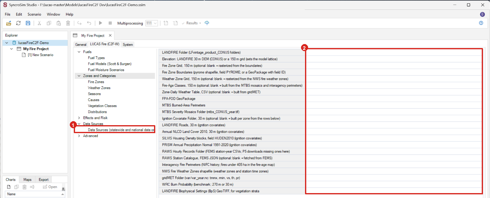

*A new project's Data Sources: (1) the sheet under Data Sources in the tree; (2) the value column, empty until you fill it.*

The rows, the stages that read them, and the paths used for this guide:

| Row | What it is | Read by | Path in this guide |
| --- | --- | --- | --- |
| LANDFIRE Folder | Folder holding the LANDFIRE product folders (LF2020\_FBFM40\_CONUS and so on) | P1, P2, P4 | `F:\lucas-master\Data Sources\FBFM` |
| Elevation | LANDFIRE 30 m DEM; sets the model lattice | P1, P2 | `F:\lucas-master\Data Sources\DEM\LF2020_Elev_220_CONUS\Tif\LC20_Elev_220.tif` |
| Fire Zone Grid, 150 m | Prebuilt fire-zone grid (shortcut) | P1 (optional) | blank |
| Fire Zone Boundaries | National pyrome shapefile (field PYROME) | P1, P2 | `F:\lucas-master\Data Sources\Pyromes\Data\Pyromes_CONUS_20200206.shp` |
| Weather Zone Grid, 150 m | Prebuilt weather-zone grid (shortcut) | P1 (optional) | blank |
| Fire-Age Classes, 150 m | Prebuilt fire-age grid (shortcut) | P1 (optional) | blank |
| Zone-Daily Weather Table | Prebuilt zone weather (shortcut) | P3 (optional) | blank |
| FPA-FOD GeoPackage | Fire Program Analysis fire-occurrence database | P2, C1 | `F:\lucas-master\Data Sources\FPA-FOD\Data\FPA_FOD_20221014.gpkg` |
| MTBS Burned-Area Perimeters | MTBS perimeter shapefile | P3, C7 | `F:\lucas-master\Data Sources\MTBS\Fire Perimeter\mtbs_perimeter_data\mtbs_perims_DD.shp` |
| MTBS Severity Mosaics Folder | Annual MTBS severity mosaics (mtbs\_CONUS\_year.tif) | P1, P4 | `F:\lucas-master\Data Sources\MTBS\Burn Severity` |
| Ignition Covariate Folder, 30 m | Prebuilt covariates (shortcut) | P2 (optional) | blank |
| LANDFIRE Roads, 30 m | Road map for the road-distance covariate | P2 | `F:\lucas-master\Data Sources\Roads\LF2023_Roads_CONUS\Tif\LF2023_Roads_CONUS.tif` |
| Annual NLCD Land Cover 2010, 30 m | Land cover for the development covariates | P2 | `F:\lucas-master\Data Sources\NLCD\Annual NLCD\Annual_NLCD_LndCov_2010_CU_C1V0.tif` |
| SILVIS Housing Density blocks | SILVIS v4 geodatabase (field HUDEN2010) | P2 | `F:\lucas-master\Data Sources\WUI\v4_CONUS\Data\CONUS_WUI_block_1990_2020_change_v4.gdb` |
| PRISM Annual Precipitation Normal | PRISM 1991-2020 annual normal, 4 km | P2 | `F:\lucas-master\Data Sources\Climate\prism\normals\PRISM_ppt_30yr_normal_4kmM4_annual_bil\PRISM_ppt_30yr_normal_4kmM4_annual_bil.bil` |
| RAWS Hourly Records Folder | FEMS hourly RAWS files, one per station-year; P5 downloads missing ones here | P5 | `F:\lucasFireC2F\Data\raws\hourly` |
| RAWS Station Catalogue | FEMS station list (JSON); blank = fetched from FEMS | P5 (optional) | `F:\lucasFireC2F\Data\raws\fems_conus_raws_catalogue.json` |
| Interagency Fire Perimeters | NIFC perimeter history, for small fires in the fire-age grid | P1 | `F:\lucas-master\Data Sources\NIFS\InterAgencyFirePerimeterHistory_All_Years_View\InterAgencyFirePerimeterHistory_All_Years_View.shp` |
| NWS Fire Weather Zones | Fire weather zone shapefile | P1, P5 | `F:\lucas-master\Data Sources\Study Areas\Fire Weather Zones\fz03mr26.shp` |
| gridMET Folder | gridMET daily files, one folder per variable (tmmx, rmin, vs, th, pr), files var\_year.nc | P2, P3 | `F:\lucas-master\Data Sources\Climate\gridMET` |
| WRC Burn Probability | Wildfire Risk to Communities burn probability, the benchmark (270 m or 30 m) | C7 (optional) | `F:\lucas-master\Data Sources\WRC\california_270m\wrc_bp_270m.tif` |
| LANDFIRE Biophysical Settings (BpS) | BpS GeoTIFF, for origin-vegetation strata; its CSV\_Data folder must sit beside the Tif folder | P1 (optional) | `F:\lucas-master\Data Sources\BpS\LF2020_BPS_CONUS\LF2020_BPS_CONUS\Tif\LF2020_BPS_CONUS.tif` |

Row names in Studio are longer than in the table (for example "Elevation: LANDFIRE 30 m DEM (CONUS) or a 150 m grid (sets the model lattice)"); match on their first words. `F:\lucasFireC2F\Data` is the Data folder inside the package folder; it holds the RAWS archive and the prebuilt California shortcuts. Everything else is a national product kept in its own folder. Copy each path from the table into its row; forward or back slashes both work.

A required row that is empty or points at a missing file stops its stage with a message naming the row. The shortcut rows only change where an input comes from, never the model. Leave them blank unless you have a matching prebuilt file. The other optional rows switch a feature off when empty: no BpS means no origin-vegetation strata, no WRC means C7 scores without the benchmark. The fire-age grid needs both the MTBS mosaics and the NIFC perimeters; without them there are no recent-fire rules.

Save the library when the rows are filled (Ctrl+S). The paths are written to the library only on save; a stage run before saving sees the old, empty sheet.

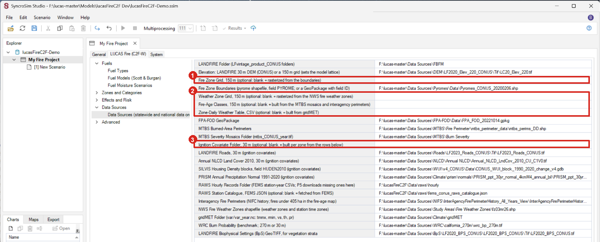

*Data Sources filled for the national route. The boxed rows are the shortcuts, left blank: (1) P1 rasterises the fire-zone grid from the pyrome boundaries; (2) P1 builds the weather-zone grid and fire-age classes, and P3 builds the zone daily weather from gridMET; (3) P2 builds the ignition covariates from the Roads, NLCD, SILVIS and PRISM rows below it.*

> **Check before moving on.** Long paths are cut off in the grid. Drag the divider between the Explorer and the properties pane to the left (as here) or click a cell to see the whole path. A path that points at the wrong copy of a file still runs, so read each row against the table rather than trusting that the stage will complain.

### 2.3 Fuel Types

Fuel Types lists every value of the LANDFIRE fuel map (FBFM40) and says what C2F-W burns in its place. A new project already holds the 45 package defaults: the 40 Scott and Burgan fuel models and five non-burnable classes. Most projects never change this sheet; read it once so you know what the model does with each fuel.

1. In the project properties, LUCAS Fire (C2F-W) tab, expand **Fuels** and select **Fuel Types**.
2. Scroll through the rows. Leave them as they are unless you are deliberately changing the model (see the note at the end of this section).

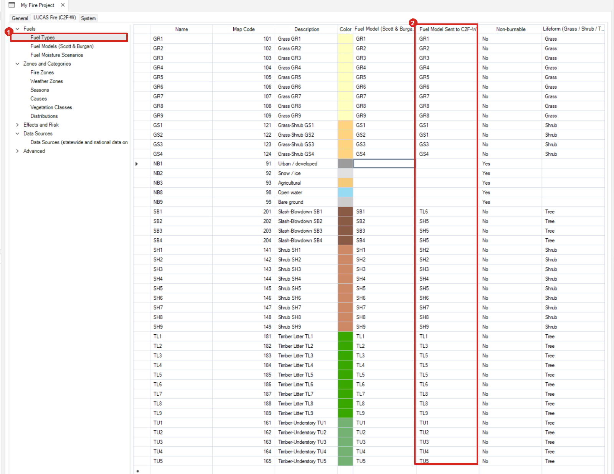

*Fuel Types with the package defaults: (1) the sheet under Fuels; (2) the model C2F-W burns for each fuel. Compare it with the column to its left: GR9, GS2, SB1-SB4, SH1, TL2, TL3, TL4 and TL7 are sent as a different model.*

| Column | What it means |
| --- | --- |
| Name | The FBFM40 code (GR1, SH5, TL3 and so on) |
| Map Code | The value of that fuel in the LANDFIRE FBFM40 raster (101 = GR1, 141 = SH1, 181 = TL1). Must match the raster exactly |
| Description | A readable label |
| Color | The colour of the fuel on maps in Studio |
| Fuel Model (Scott & Burgan) | The model LANDFIRE assigned |
| Fuel Model Sent to C2F-W | The model the engine actually burns. It differs from the previous column in 11 rows (below) |
| Non-burnable | Yes for the five NB classes (91 urban, 92 snow and ice, 93 agriculture, 98 water, 99 bare ground): they never burn and receive no ignitions |
| Lifeform | Grass, Shrub or Tree. Links each fuel to its response function in Effects and Risk |

The 11 remapped rows fall into two groups:

| LANDFIRE model | Sent to C2F-W | Why |
| --- | --- | --- |
| GR9 | GR8 | C2F-W v1.0.1 has no GR9; nearest modelled grass |
| SH1 | SH2 | No SH1 in C2F-W |
| TL7 | TL8 | No TL7 in C2F-W |
| SB1 | TL6 | No slash-blowdown models in C2F-W |
| SB2, SB3, SB4 | SH5 | As above |
| GS2 | GS1 | Calibration: slows grass-shrub spread |
| TL2 | TL3 | Calibration: C2F-W's timber litter spreads too slowly against the fire record |
| TL3 | TL5 | As above |
| TL4 | TL5 | As above (C2F-W also has no TL4) |

The four calibration remaps raise timber-litter spread by about 1.65 times. They come from the P27 calibration and have been package defaults since version 1.9.1. Every zone calibrated after that, including this guide's, assumes them.

Fuel Types sets the base fuel only. Cells that burned in the last ten years get a different fuel from the scenario's **Recent Fire Fuel Rules**, applied before this crosswalk (4.6).

> **Check before moving on.** GS2 should read GS1 in the Sent to C2F-W column, and TL2, TL3 and TL4 should read TL3, TL5 and TL5. If they read GS2, TL2, TL3 and TL3, the project was created under a package older than 1.9.1: update the package and re-check, because the spread-day calibration assumes the remaps. If you do change a Sent to C2F-W value deliberately, recalibrate (stage C5) before trusting the results.

### 2.4 Fuel Models (Scott & Burgan)

Fuel Models holds the published parameters of the 40 Scott and Burgan (2005) fuel models, in metric units. A new project already has all 40; like Fuel Types, it is a reference sheet you read, not one you fill.

1. Under **Fuels**, select **Fuel Models (Scott & Burgan)**.
2. Check that the sheet has 40 rows, GR1 to TU5, and leave it as it is.

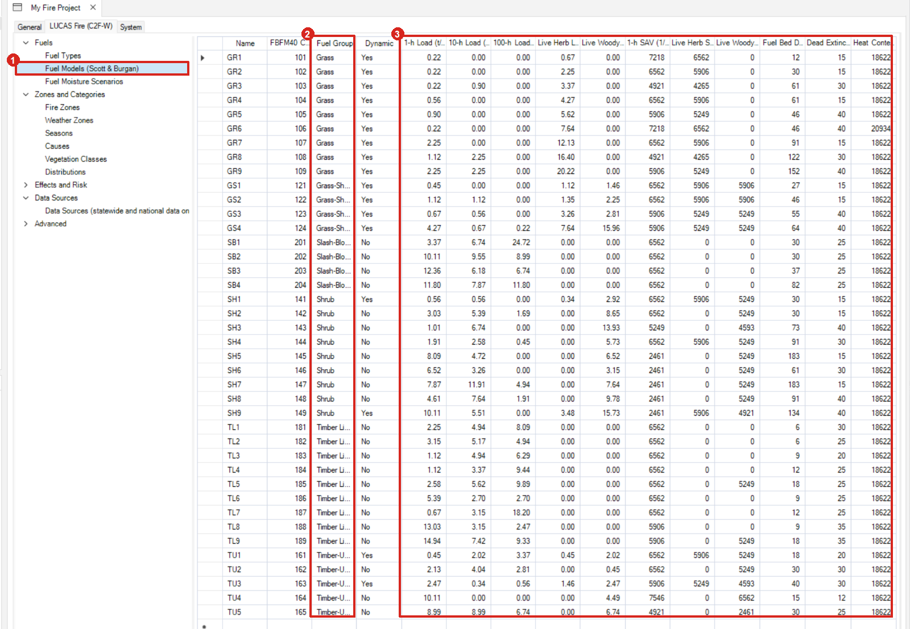

*Fuel Models: (1) the sheet under Fuels; (2) Fuel Group, used to group results and targets by fuel; (3) the Rothermel fuel-bed parameters used for fire effects.*

The sheet does not set how fast fire spreads. C2F-W spreads fire with its own built-in copy of the Scott and Burgan models, chosen by the code in Fuel Types' Sent to C2F-W column. The package uses this sheet in three other ways:

| Columns | Used by | For |
| --- | --- | --- |
| Name | P1 | Every burnable Fuel Type must send C2F-W a model named here; otherwise P1 stops and names the fuel type |
| Fuel Group | P2, P4, C7 | The fuel term of the ignition fit, the MTBS severity target (class shares by fuel group) and the validation tables by fuel. Six groups: Grass, Grass-Shrub, Shrub, Timber-Understory, Timber Litter, Slash-Blowdown |
| Dynamic, loads, SAV, depth, extinction moisture, heat content | Effects (stages 6 and 8) | The package's own Rothermel (1972) surface-fire calculation, which gives flame length, intensity and crown-fire initiation for each burned cell from its fuel model and the day's weather |

Dynamic models (all grass and grass-shrub models, SH1, SH9, TU1, TU3) move part of their live herbaceous load into the dead class as the herbs cure, as Scott and Burgan specify.

> **Leave the values as published.** The calibration and the severity target were fitted with them. Editing a load or depth changes fire effects for every scenario in the project; renaming a model or changing its Fuel Group breaks the links from Fuel Types and the severity target.

### 2.5 Fuel Moisture Scenarios

C2F-W does not compute fuel moisture from the weather. It takes one of four fixed Scott and Burgan moisture scenarios for the whole of each fire, from very dry (D1L1) to wet (D4L4). This sheet holds those four, and a new project already has them.

1. Under **Fuels**, select **Fuel Moisture Scenarios**.
2. Check the four rows, D1L1 to D4L4, numbered 1 to 4, and leave them as they are.

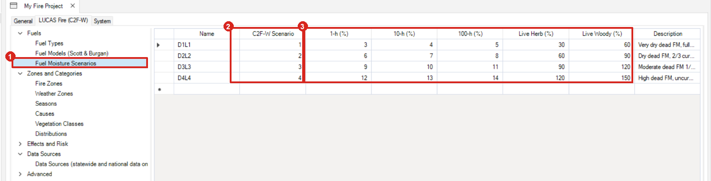

*Fuel Moisture Scenarios: (1) the sheet under Fuels; (2) the scenario number C2F-W is given; (3) the moisture of each fuel class in that scenario, in percent.*

| Name | Dead fuel (1-h / 10-h / 100-h) | Live herb / live woody | Meaning |
| --- | --- | --- | --- |
| D1L1 | 3 / 4 / 5 % | 30 / 60 % | Very dry dead fuel, herbs fully cured |
| D2L2 | 6 / 7 / 8 % | 60 / 90 % | Dry dead fuel, herbs two-thirds cured |
| D3L3 | 9 / 10 / 11 % | 90 / 120 % | Moderate dead fuel, herbs one-third cured |
| D4L4 | 12 / 13 / 14 % | 120 / 150 % | Moist dead fuel, herbs uncured |

Stage 3 picks the scenario for each fire. The dead class comes from the equilibrium moisture content of the fire's first spread day (from its temperature and humidity), placed against the scenario's **Dead Fuel Moisture Classes**. The live class comes from the season (**Seasons** sheet, 2.8). The fire gets the wetter of the two. Stage 4 passes the number to C2F-W, and the effects stages use the same four rows for their fire-behaviour calculation.

> **Keep the C2F-W Scenario numbers 1 to 4.** They are C2F-W's own scenario numbers, and the effects stages stop if they do not run 1, 2, 3, 4. Changing a moisture value changes the fire-behaviour effects but not C2F-W's spread, which uses its built-in values for each number.

### 2.6 Fire Zones

A fire zone is the unit the model is prepared, calibrated and run on. lucasFireC2F uses the 128 pyromes of the conterminous US (Short et al. 2020), the same units FSim and Wildfire Risk to Communities were simulated on, so a zone's burn probability can be compared directly with WRC. A new project lists all 128.

1. Under **Zones and Categories**, select **Fire Zones**.
2. Find **P18 Southern Cascades** (Map Code 1018), the zone this guide builds. You choose it later, per scenario, in Zone Preparation Options (chapter 3); nothing is selected here.

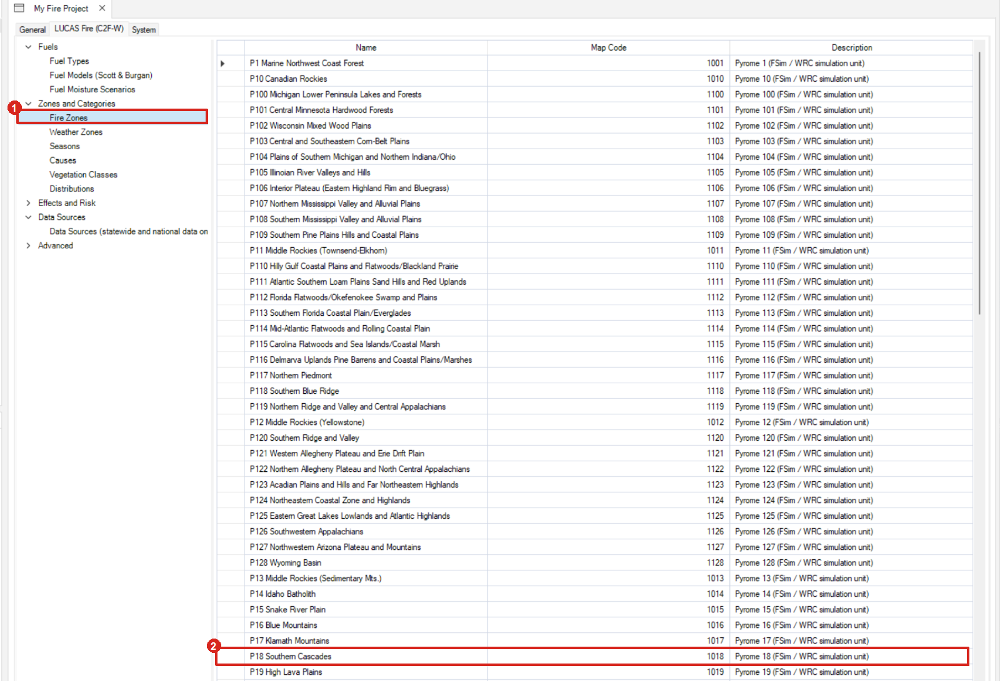

*Fire Zones: (1) the sheet under Zones and Categories; (2) P18 Southern Cascades, Map Code 1018.*

The Map Code is 1000 + the pyrome number. P1 writes it into the fire-zone grid, and every later stage finds the zone's cells by it. The rows sort as text (P1, P10, P100, P101...), so scroll or click the Map Code header to sort by number.

> Leave the names and codes as they are. Zone results from different libraries merge (stage M) by Map Code, and the pyrome shapefile is matched on the same numbers.

### 2.7 Weather Zones

Weather zones are the NWS fire weather zones, 3,373 of them across CONUS. Each cell of a fire zone belongs to one, and fires draw their daily weather from it. A new project lists them all; you do not edit them.

1. Under **Zones and Categories**, select **Weather Zones**.
2. Look, but do not edit. The list starts with Alabama because it sorts by name.

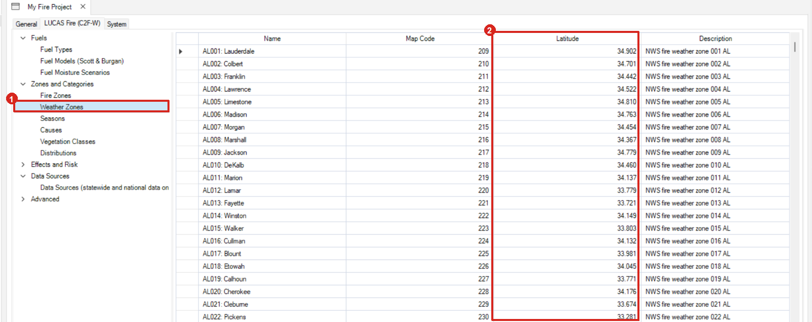

*Weather Zones: (1) the sheet under Zones and Categories; (2) Latitude of the zone's centre.*

| Column | Used for |
| --- | --- |
| Name | State, zone number and NWS name (for example CA282: Shasta-Trinity National Forest in Siskiyou County). P1 matches the shapefile's zones to these names |
| Map Code | The zone's value in the weather-zone grid. The 208 California zones keep codes 1-208 from the California libraries; the rest follow from 209 |
| Latitude | Day length in the fire-weather (FWI) calculation of stage C2 |

P18 touches 13 of these zones, all in northern California, from Siskiyou County and the Shasta Valley south through Lassen Volcanic National Park to the Sierra Nevada of Tehama, Butte and Plumas counties. P1 finds which ones, P3 builds daily weather for each, and C2 turns that into the spread-day weather stream (chapter 4).

### 2.8 Seasons

Seasons split the year for three purposes: how ignitions are spread through the year, which weather a fire draws, and the live fuel moisture C2F-W is given. A new project has four.

1. Under **Zones and Categories**, select **Seasons**.
2. Check the four rows and leave them as they are.

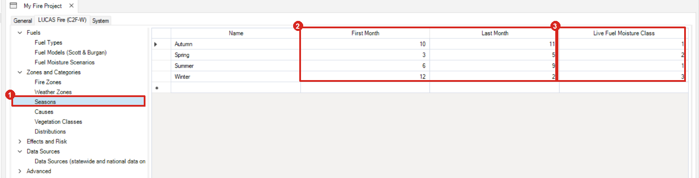

*Seasons: (1) the sheet under Zones and Categories; (2) the months of each season; (3) the live fuel moisture class.*

| Season | Months | Live fuel moisture class |
| --- | --- | --- |
| Spring | March-May | 2 (herbs two-thirds cured) |
| Summer | June-September | 1 (fully cured) |
| Autumn | October-November | 1 (fully cured) |
| Winter | December-February | 3 (herbs one-third cured) |

Winter wraps over the new year (First Month 12, Last Month 2). The live class is a Fuel Moisture Scenario number (2.5): stage 3 gives each fire the wetter of this class and the dead-fuel class of its first day.

> **Months must cover the year once.** Every fire in the record is assigned to a season by its discovery month (C3), and the weather stream is split the same way (C2). A gap or overlap leaves fires or weather days without a season. If you change the seasons, rerun the calibration stages.

### 2.9 Causes

Two ignition causes, Human and Lightning. They have separate ignition-probability surfaces (P2), separate shares of each season's fires (C3) and, by default, separate spread-day curves (C5).

1. Under **Zones and Categories**, select **Causes**.
2. Check the two rows and leave them.

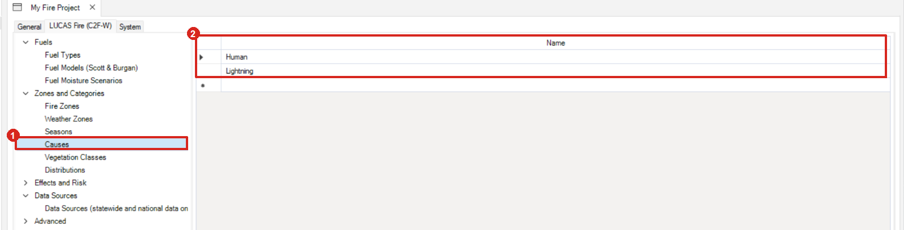

*Causes: (1) the sheet under Zones and Categories; (2) the two causes.*

The names must stay exactly Human and Lightning: P2 maps FPA-FOD's cause classes onto them (Natural to Lightning, Human to Human; fires of unknown cause are left out).

### 2.10 Vegetation Classes

Vegetation classes describe a cell's potential vegetation, from LANDFIRE Biophysical Settings (BpS), as opposed to its current fuel. They let the calibration fit separate spread-day curves for fires that start in, say, conifer and shrub country. Because BpS is the vegetation the site would support, not what grows there now, a cell's class does not change after a fire, and the curves carry no memory of recent burns.

1. Under **Zones and Categories**, select **Vegetation Classes**.
2. Check the five rows and leave them.

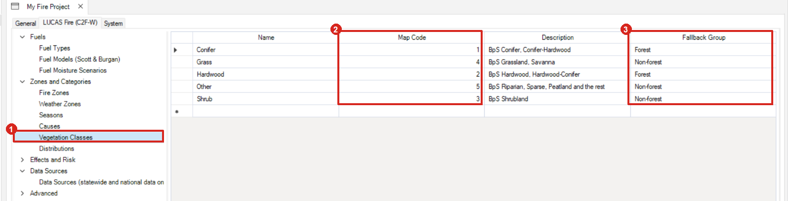

*Vegetation Classes: (1) the sheet under Zones and Categories; (2) the class code written into the vegetation map; (3) the fallback group.*

| Class | BpS vegetation groups (GROUPVEG) | Fallback group |
| --- | --- | --- |
| Conifer | Conifer, Conifer-Hardwood | Forest |
| Hardwood | Hardwood, Hardwood-Conifer | Forest |
| Shrub | Shrubland | Non-forest |
| Grass | Grassland, Savanna | Non-forest |
| Other | Riparian, Sparse, Peatland and every other group | Non-forest |

P1 reads the BpS raster and its attribute table (the CSV\_Data folder beside its Tif folder), maps each BpS value onto a class by the rules above and writes the modal class of each 150 m cell into the vegetation map. C5 uses the map only when Spread Days Fitted By includes origin vegetation; the default is by cause alone.

When a class has fewer recorded fires than the calibration minimum (25 by default), C5 does not fit it alone. It falls back from cause and vegetation, to vegetation, to the **Fallback Group** (Forest or Non-forest), and finally to one curve for all fires. The group step keeps a small shrub or grass class off a curve dominated by large timber fires.

> The class names must stay Conifer, Hardwood, Shrub, Grass and Other: P1 matches them by name. Leave the BpS row empty in Data Sources and there is no vegetation map; fitting by cause, the default, still works.

### 2.11 Distributions

Distributions is a short list of the probability distributions that sheets elsewhere can choose from. Its main use is the scenario's **Ignition Count**, the number of fires per season.

1. Under **Zones and Categories**, select **Distributions**.
2. Check the four rows and leave them.

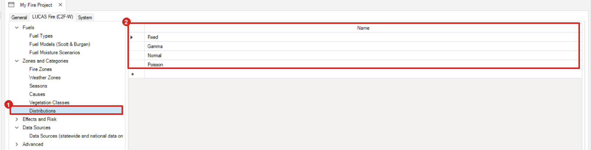

*Distributions: (1) the sheet under Zones and Categories; (2) the four distributions.*

| Distribution | Fires per season |
| --- | --- |
| Gamma | Drawn from a gamma distribution with the given mean and SD. C3 fits this one to the fire record: the default, and the one to use |
| Normal | Drawn from a normal distribution with the given mean and SD |
| Poisson | Drawn from a Poisson distribution with the given mean |
| Fixed | Always the mean |

The draw is rounded and kept within the Min and Max set in Ignition Count (Min defaults to 1, so every season has at least one fire). The names are matched by stage 2, so leave them as they are.

This completes the Zones and Categories sheets. All of them come with the package and need no editing for P18.

### 2.12 Effects and Risk

The four sheets under **Effects and Risk** describe the fire-behaviour and risk maps that stages 6 (Fire Effects) and 7 (Hazard and Risk) produce. They follow the Wildfire Risk to Communities (WRC) version 2 approach (Scott et al. 2024), without a housing layer: the risk maps describe *potential* structures, the loss a building would suffer if it stood in the cell. All four come with the package; read them so you know what the result maps mean.

#### Lifeforms and Response Functions

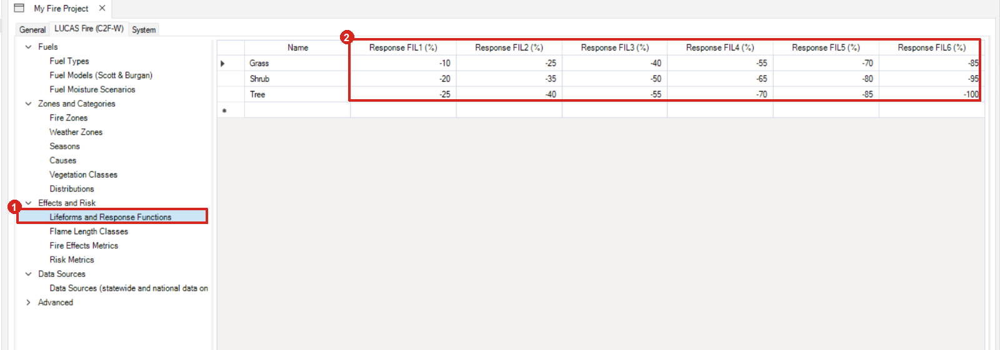

*Lifeforms and Response Functions: (1) the sheet under Effects and Risk; (2) the response, in percent change, for each of the six flame-length classes.*

Each row gives the percent change in value a structure suffers when fire reaches it at each flame-length class, by the lifeform of the surrounding fuel. Values are negative (loss): a tree-fuel cell burning at over 12 ft (FIL6) means total loss (-100%); a grass cell burning under 2 ft (FIL1) a 10% loss. The lifeform of each cell comes from Fuel Types (2.3), using the fuel C2F-W burned. Stage 7 multiplies each cell's flame-length class probabilities by these responses to get the conditional risk (CRPS).

#### Flame Length Classes

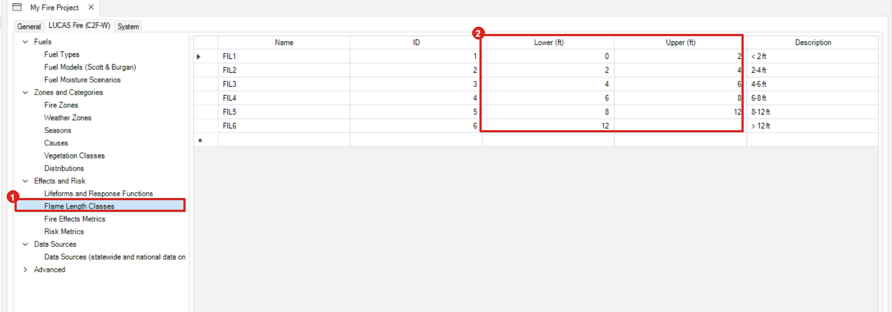

*Flame Length Classes: (1) the sheet under Effects and Risk; (2) the bounds of each class, in feet.*

The six FSim flame-intensity classes: under 2 ft, 2-4, 4-6, 6-8, 8-12 and over 12 ft. They label the classes used in Fire Effects Metrics and the response functions. The bounds themselves are fixed in stage 6 to match FSim and WRC, so editing them here does not change the results.

#### Fire Effects Metrics

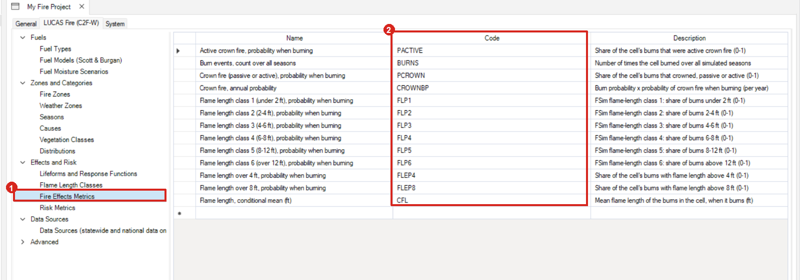

*Fire Effects Metrics: (1) the sheet under Effects and Risk; (2) the code stage 6 writes each map under.*

| Code | Map |
| --- | --- |
| CFL | Conditional flame length: mean flame length of the cell's burns, when it burns (ft) |
| FLEP4, FLEP8 | Share of the cell's burns with flame length over 4 ft and over 8 ft |
| FLP1-FLP6 | Share of the cell's burns in each FSim flame-length class |
| PCROWN, PACTIVE | Share of the cell's burns that crowned (passive or active), and that were active crown fire |
| CROWNBP | Annual crown-fire probability: burn probability x PCROWN |
| BURNS | Number of times the cell burned over all simulated seasons |

All except BURNS and CROWNBP are *conditional*: they describe what happens when the cell burns, not how often it does.

#### Risk Metrics

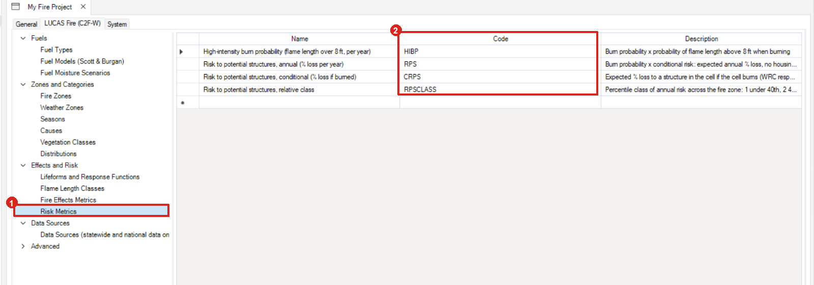

*Risk Metrics: (1) the sheet under Effects and Risk; (2) the code stage 7 writes each map under.*

| Code | Map |
| --- | --- |
| HIBP | High-intensity burn probability: burn probability x FLEP8 (per year) |
| CRPS | Conditional risk to potential structures: expected % loss if the cell burns |
| RPS | Risk to potential structures: burn probability x CRPS (expected % loss per year) |
| RPSCLASS | RPS as a percentile class over the fire zone: 1 under the 40th percentile, 2 40-70th, 3 70-90th, 4 90-95th, 5 over the 95th |

Burn probability and CRPS are spread into non-burnable ground (towns, roads) from the surrounding burnable patches, as WRC does, so a town carries the risk of the land around it.

> **Keep the Codes.** The stages find each map by its Code; the Name is only the label you see in Studio's Maps and results, and can be reworded. The response functions can be changed if you have better local values; rerun stage 7 to apply them.

### 2.13 Advanced: Fire Record Sources

**Advanced** holds one sheet, Fire Record Sources: the labels for where each fire in a scenario's Historical Fire Record came from.

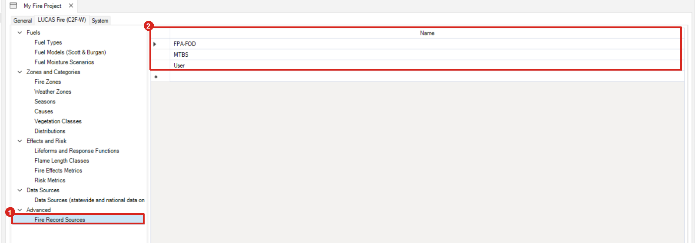

*Fire Record Sources: (1) the sheet under Advanced; (2) the three source labels.*

| Source | Meaning |
| --- | --- |
| FPA-FOD | Fires imported by stage C1 from the FPA-FOD database. Rerunning C1 replaces these rows and only these |
| MTBS | Reserved for MTBS records. No stage writes it at present |
| User | Fires you add to the Historical Fire Record yourself, for example from a local fire history. C1 keeps them when it reimports |

Leave the three names as they are: C1 looks for the FPA-FOD label when it replaces rows.

### 2.14 Project data complete

The project now holds everything the scenarios share:

- **Data Sources** pointing at the national datasets, with the five shortcut rows blank (2.1-2.2).
- The package defaults for **Fuels**, **Zones and Categories**, **Effects and Risk** and **Advanced**, checked but unchanged (2.3-2.13).

Save the library (Ctrl+S). Nothing has been computed yet: the zone's grids, weather and ignition surfaces are built by the first scenario in chapter 3.

## 3. Prepare the zone (Prep)

The Prep scenario builds everything the zone needs from the national data: its grids and fuels (P1), ignition-probability surfaces (P2), daily weather (P3), the MTBS severity target (P4) and the burning-period wind table (P5). Calibrate and Run take its result as a dependency, so it runs once per zone and fuel vintage.

### 3.1 Name and describe the scenario

A new library already has one scenario, **\[1\] New Scenario**. Use it for Prep.

1. Double-click **\[1\] New Scenario** in the Explorer to open its properties. The **General** tab opens on **Summary**.
2. In **Name**, type `P18 Southern Cascades - Prep`.
3. In **Description**, paste the text below. It records what the scenario is for and how it is set; update it if you change a setting.
4. Save (Ctrl+S).

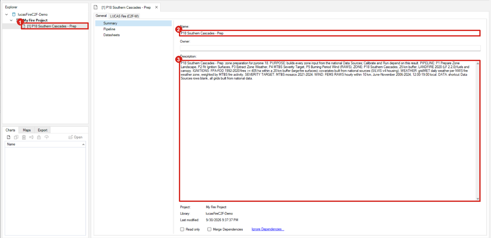

*Scenario Summary: (1) the scenario in the Explorer; (2) Name; (3) Description.*

```
P18 Southern Cascades - Prep: zone preparation for pyrome 18. PURPOSE: builds every zone input from the national Data Sources; Calibrate and Run depend on this result. PIPELINE: P1 Prepare Zone Landscape, P2 Fit Ignition Surfaces, P3 Extract Zone Weather, P4 MTBS Severity Target, P5 Burning-Period Wind (RAWS). ZONE: P18 Southern Cascades, 25 km buffer, LANDFIRE 2020 (LF 2.2.0) fuels and canopy. IGNITIONS: FPA-FOD 1992-2020 fires >= 405 ha within a 20 km buffer (large-fire surfaces); covariates built from national sources (SILVIS v4 housing). WEATHER: gridMET daily weather per NWS fire weather zone, weighted by MTBS fire activity. SEVERITY TARGET: MTBS mosaics 2021-2024. WIND: FEMS RAWS hourly within 10 km, June-November 2006-2024, 12:00-19:00 local. DATA: shortcut Data Sources rows blank, all grids built from national data.
```

Studio's Description box drops line breaks when you paste, so the template is one paragraph with a capitalised label for each item.

> The Owner field is optional. The Description is copied to every result the scenario produces, so a result you open months later still says how it was made.

### 3.2 Set the pipeline

The pipeline lists the stages this scenario runs, in order. Prep runs the five preparation stages.

1. On the **General** tab, select **Pipeline**.
2. Click the empty row's **Stage** cell and choose **P1 - Prepare Zone Landscape** from the list. Run Order fills in as 1.
3. Add **P2 - Fit Ignition Surfaces**, **P3 - Extract Zone Weather**, **P4 - MTBS Severity Target** and **P5 - Burning-Period Wind (RAWS)** the same way, one per row.
4. Click outside the grid so the last row is committed (the pencil at its left disappears), then save (Ctrl+S).

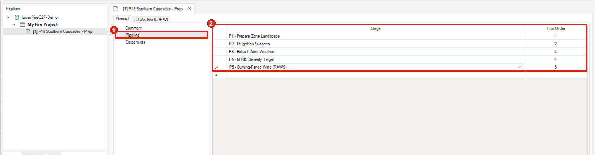

*Pipeline: (1) Pipeline under the General tab; (2) the five Prep stages with their run order.*

| Stage | Builds | Time for P18 |
| --- | --- | --- |
| P1 Prepare Zone Landscape | 150 m fuel, canopy, elevation, fire-zone, weather-zone, fire-age and vegetation grids; the zone boundary | 2 min 25 s |
| P2 Fit Ignition Surfaces | the 30 m covariates for the fit domain (about 5 min of this), then human and lightning ignition-probability maps | 6 min 51 s |
| P3 Extract Zone Weather | daily gridMET weather, 1979-2024, for the 28 weather zones on the zone's grid | 4 min 32 s |
| P4 MTBS Severity Target | observed burn-severity shares by fuel group, 2021-2024 | 41 s |
| P5 Burning-Period Wind (RAWS) | afternoon wind ratios from the 28 RAWS stations in and near the zone; downloads missing station-years from FEMS | 6 min 43 s, most of it downloading 342 station-years |

The stages must run in this order: P2 and P3 read the grids P1 writes, and P5 reads P3's daily weather. The whole P18 Prep run took 21 minutes on a 2026 workstation; a rerun is quicker because the RAWS records are already on disk.

### 3.3 Zone Preparation Options

The scenario's **LUCAS Fire (C2F-W)** tab lists only the sheets its pipeline stages use, grouped by stage. For Prep that is: the inputs you set (Zone Preparation Options, Wind Table Options) and the outputs P1-P5 will write (Zone Boundary, Ignition Surface Fit, Landscape Maps, Canopy Maps, Ignition Probability Maps, Burning-Period Wind Ratio Table, MTBS Severity Target, Daily Weather, RAWS Stations). The output sheets stay empty until the scenario runs.

1. Select the **LUCAS Fire (C2F-W)** tab and, under **Zone Preparation**, select **Zone Preparation Options**.
2. Fill the values below. Only **Fire Zone** is required: a blank field takes the value in the Default column, but typing it in records the setting in the scenario.
3. Save (Ctrl+S).

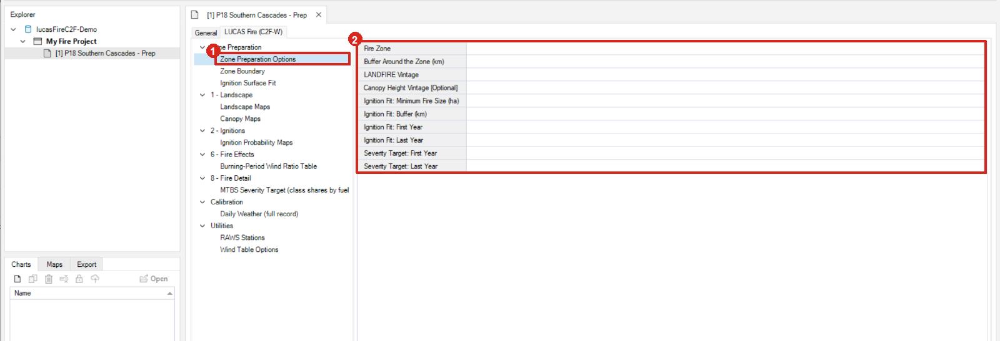

*Zone Preparation Options: (1) the sheet under Zone Preparation; (2) the ten settings, empty in a new scenario.*

| Field | P18 value | Default | Used by | What it does |
| --- | --- | --- | --- | --- |
| Fire Zone | P18 Southern Cascades | none (required) | P1-P5 | The pyrome to prepare, chosen from the project's Fire Zones |
| Buffer Around the Zone (km) | 25 | 25 | P1 | The landscape extends this far past the pyrome edge, so fires that start inside can spread out and fires from outside can burn in |
| LANDFIRE Vintage | 2020 | 2020 | P1, P2, P4 | Which LANDFIRE product folders to read (LF2020\_FBFM40\_CONUS and so on) |
| Canopy Height Vintage \[Optional\] | blank | the LANDFIRE vintage | P1 | A different vintage for canopy height only |
| Ignition Fit: Minimum Fire Size (ha) | 405 | 405 | P2 | Only fires at least this large train the ignition surfaces: the large-fire surfaces place the fires that matter for burn probability |
| Ignition Fit: Buffer (km) | 20 | 20 | P2 | The fit domain: the pyrome plus this buffer, for enough fires to fit |
| Ignition Fit: First Year / Last Year | 1992 / 2020 | 1992 / 2020 | P2 | The FPA-FOD years used; the 6th edition ends in 2020, so 2021 on stays an out-of-sample test |
| Severity Target: First Year / Last Year | 2021 / 2024 | 2021 / 2024 | P4 | The MTBS severity years the effects calibration is matched to, the years after the 2020 fuels |

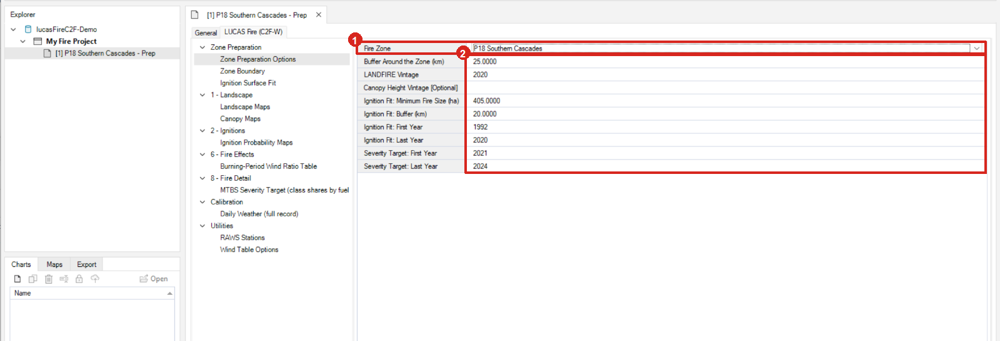

*Zone Preparation Options filled for P18: (1) Fire Zone, chosen from the drop-down; (2) the other settings. Studio shows decimals as 25.0000 and 405.0000; that is only display.*

> **Match the severity years to the fuels.** The severity target starts in 2021 because MTBS severity is compared with fire on the LANDFIRE 2020 fuels, so it takes the years after that vintage. For another vintage, move the severity window with it. The ignition window follows the FPA-FOD record instead and needs no change.

### 3.4 Wind Table Options

C2F-W needs hourly wind, but the zone's weather (P3) is daily: gridMET's daily mean 10 m wind. Stage P5 bridges the two. It pairs afternoon hourly wind at nearby RAWS stations with the same days' gridMET wind and writes the **Burning-Period Wind Ratio Table**: for each band of daily wind speed, the spread of hourly-to-daily ratios. Stage 3 then draws each burning hour's wind from that table.

1. Under **Utilities**, select **Wind Table Options**.
2. Type the defaults from the table below, leaving Time Zone blank, and save (Ctrl+S). An empty sheet would run on the same values, but filling it records them in the scenario.

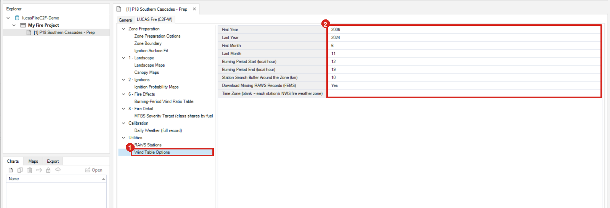

*Wind Table Options: (1) the sheet under Utilities; (2) the settings, here the package defaults with Time Zone blank.*

| Field | Default | What it does |
| --- | --- | --- |
| First Year / Last Year | 2006 / 2024 | RAWS years used (the window the California wind tables were built on) |
| First Month / Last Month | 6 / 11 | June to November, the fire season the ratios represent |
| Burning Period Start / End (local hour) | 12 / 19 | Only noon to 7 pm hours count: the hours fires spread |
| Station Search Buffer Around the Zone (km) | 10 | Stations inside the pyrome or within this distance of it |
| Download Missing RAWS Records (FEMS) | Yes | Fetch station-years not yet in the RAWS Hourly Records Folder from FEMS |
| Time Zone | blank | Blank: each station's local time comes from its NWS fire weather zone. Type a time-zone name (for example America/Los\_Angeles or America/Denver) to use one for all stations. With neither, stations are taken as Pacific time and the log warns |

The **RAWS Stations** sheet above it is an output: P5 lists the stations it used there.

> **First run downloads.** With Download Missing on, the first P5 run for a zone fetches every missing station-year from FEMS into `F:\lucasFireC2F\Data\raws\hourly`, which can take a while; later runs and neighbouring zones reuse the files. Stations P18 shares with the Sierra zones may already be there; expect the rest to download on this run. Hourly wind is checked as it is read: values outside 0-150 km/h are dropped.

### 3.5 Run the Prep scenario

1. In the Explorer, select **P18 Southern Cascades - Prep**.
2. Start the run in either of two ways:
   - right-click the scenario and choose **Run**, or
   - click **Run** (the green triangle) on the toolbar.

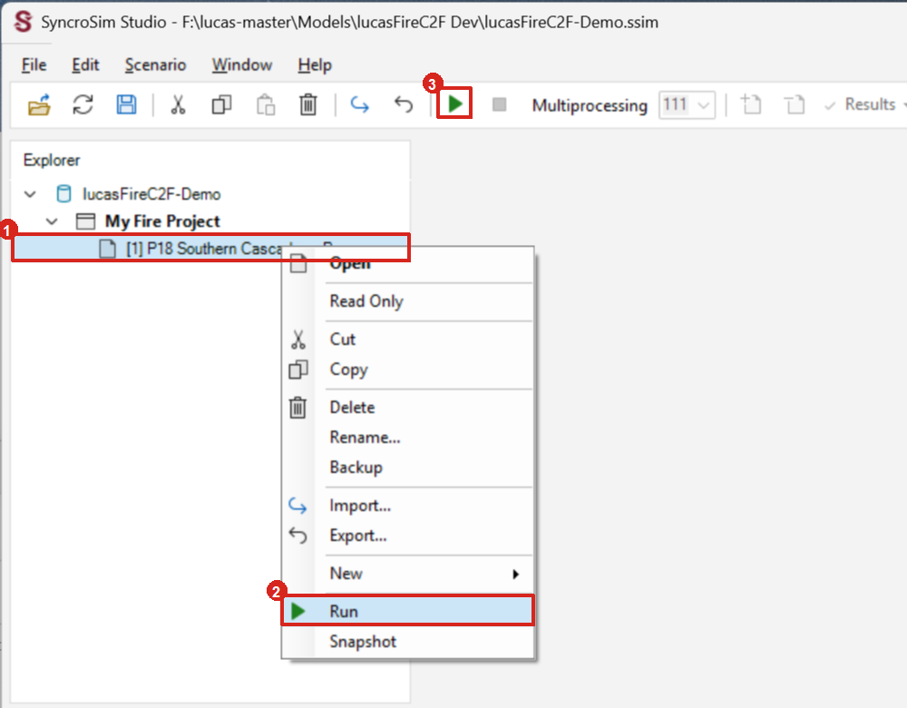

*Starting a run: (1) the scenario in the Explorer; (2) Run on its right-click menu; (3) the same command on the toolbar.*

3. Studio asks to save the library first. Click **Yes**: the run uses the saved library, so unsaved edits would not be in it.

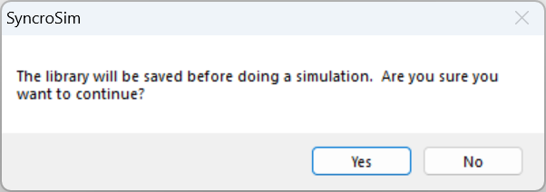

*Studio saves the library before every run.*

4. The **Run Monitor** opens. It lists the run with its Result Id and Status, and the bar at the bottom of the window shows the stage running now. Leave Studio open until the status changes; it can be minimised.

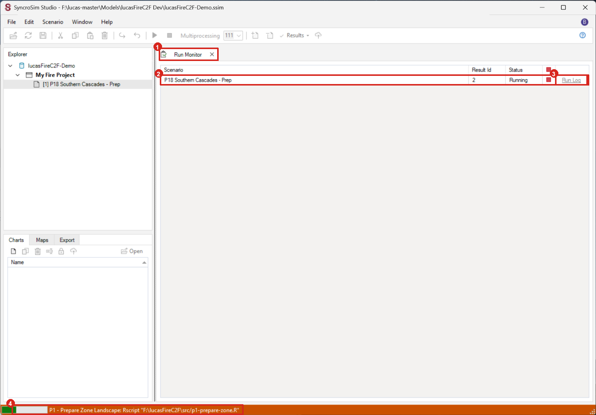

*Run Monitor: (1) the Run Monitor tab; (2) the run, its Result Id (the number of the result scenario it will create) and Status; (3) Run Log, the stage messages so far; (4) the status bar with the current stage, here P1 - Prepare Zone Landscape.*

To stop a run, click the red square in its row. The partial result is kept and can be deleted. Click **Run Log** at any time to see each stage's messages: what it read, what it built and how long it took. If a stage fails, the log names the problem, usually a missing Data Sources row or file.

When the run finishes, a **Results** folder appears under the scenario, holding a result scenario named after it with the run's date and time. That result, not the Prep scenario itself, is what Calibrate and Run will depend on.

### 3.6 Check the Prep result

When the run finishes, open **Run Log** and read it from the top. Each stage reports what it built; check these lines against what you expect for the zone.

| Stage | Log line (P18) | What to check |
| --- | --- | --- |
| P1 | `P18 Southern Cascades (Map Code 1018): 13900 km2, buffer 25 km; grid 2049 x 1161` | The right zone, a sensible area, and the grid size (2.4 million 150 m cells) |
| P1 | `fire zones rasterized ...: 1004, 1006, 1017, 1018, ...` and `weather zones ...: 28 zones on the grid` | Neighbouring pyromes and weather zones inside the 25 km buffer are expected |
| P1 | `fuel types (LF2020 FBFM40): 91 92 93 ... 202` | Every code must be in Fuel Types (2.3); P1 stops if one is not |
| P1 | `LANDFIRE CH LF2020: using LC22_CH_220.tif (non-standard file name)` | Expected for LF 2020 canopy height (2.1) |
| P1 | `years since fire ...: 2 yr: 54355, 5 yr: 35474, 10 yr: 37398` | Recent burns found; 2020 and 2018 were large fire years here |
| P2 | `presences in the domain: 114 (48 human, 66 lightning)` | Enough large fires to fit; under about 30 per cause, consider a larger Ignition Fit buffer |
| P2 | `Human: ... AUC 0.660`, `Lightning: ... AUC 0.650` | Spatially cross-validated skill; 0.6-0.75 is typical for pyromes |
| P3 | `daily weather: 470,456 rows, 28 weather zones, 1979-01-01 to 2024-12-31` | Every weather zone on the grid, the full record |
| P4 | `2021: 2,351,260 burned 30 m pixels`, `2023: 0`, `2024: 0` | Which fire years the severity target rests on (below) |
| P5 | `655,233 from 28 stations`, `overall median ratio 0.65` | Enough stations and hours; per-station medians listed |

Two warnings at the top of the log are harmless: that the package was built for an undetermined SyncroSim version, and that conda is disabled (lucasFireC2F uses the R set in 1.7).

> **What this P18 log shows.** Two things are worth noting, neither of which stops the model. (1) The severity target is almost entirely 2021, the year of the Dixie Fire: 2,351,260 of 2,352,228 burned pixels. The 2023 and 2024 MTBS mosaics in this release have no burned pixels in P18. The class shares therefore describe one extreme fire year. (2) One RAWS station, Panther Springs, has a median ratio of 0.00: most of its afternoon hours that pass the quality flag read 0 mph, a sheltered or faulty anemometer. It contributes a few percent of the hours and slightly lowers the bottom of the wind table.

In the Explorer, the Prep scenario now has a **Results** folder holding **\[2\] P18 Southern Cascades - Prep (\[1\] @ 30-Sep-2026 9:53 PM)**: the parent's name, its ID and the run time. Open it to see the output sheets filled: Landscape Maps, Canopy Maps, Ignition Probability Maps, Daily Weather, MTBS Severity Target, RAWS Stations and the Burning-Period Wind Ratio Table.

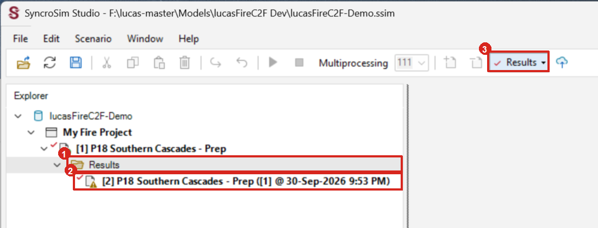

*The Prep result: (1) the Results folder under the scenario; (2) result \[2\], named after its parent with the run time; the yellow triangle means the run finished with warnings, here only the package-version warning; (3) the Results button, which shows only the scenarios ticked in red when you open charts and maps.*

Chapter 4 makes this result a dependency of the Calibrate scenario.

## 4. Calibrate the zone (Calibrate)

The Calibrate scenario fits the zone's fire regime to the fire record. It imports the zone's FPA-FOD fires (C1), builds the spread-day weather stream (C2), fits how many fires start each season and when (C3), runs a **seed run**: stages 1-5 with each fire burning a random 1 to 25 days, then fits the spread-day distribution that makes the simulated fire sizes match the record (C5). It scores nothing against the record: the fitted curve is first used in the Run scenario, and C6 scores it there (chapter 5). It runs on the Prep result, so it needs nothing rebuilt.

### 4.1 Create the scenario

1. In the Explorer, right-click **My Fire Project** (or empty space below the scenarios) and choose **New**, then **Scenario...**.

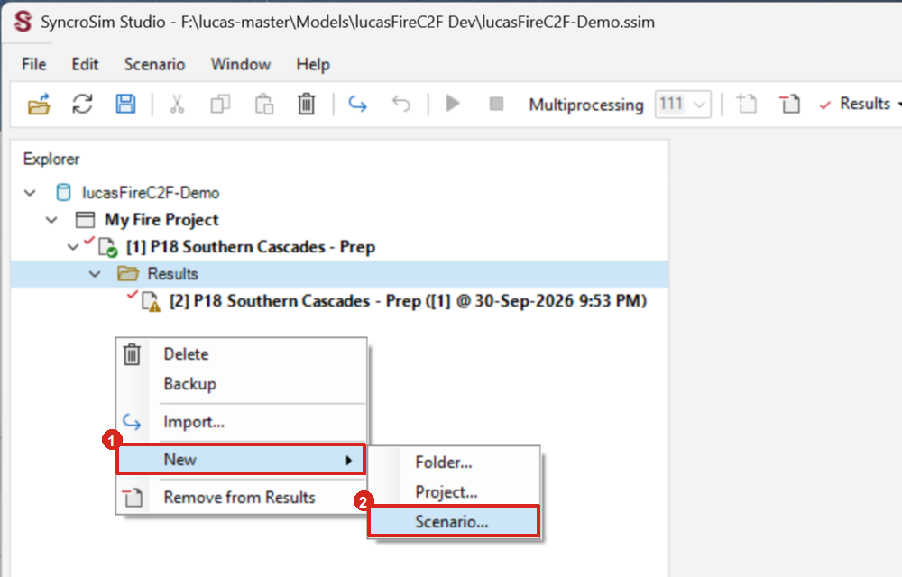

*Creating a scenario: (1) New on the right-click menu; (2) Scenario...*

2. In the **New Scenario** window, type the name `P18 Southern Cascades - Calibrate` and click **OK**. Leave the Description for now: section 4.6 fills it once the settings are chosen.

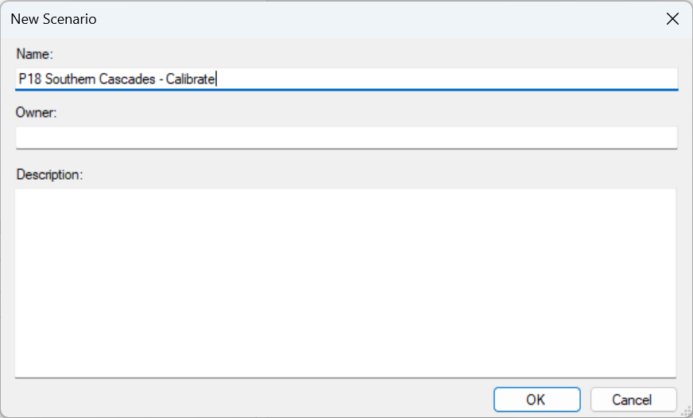

### 4.2 Add the Prep result as a dependency

A dependency makes a scenario read another scenario's data instead of its own. Calibrate depends on the Prep result, so it sees the zone's landscape maps, ignition surfaces, daily weather, severity target and wind table without copying them.

1. Expand the Prep scenario's **Results** folder.
2. Drag the result **\[2\] P18 Southern Cascades - Prep (...)** and drop it on **\[3\] P18 Southern Cascades - Calibrate**.
3. Expand the Calibrate scenario: a **Dependencies** folder now lists the Prep result.

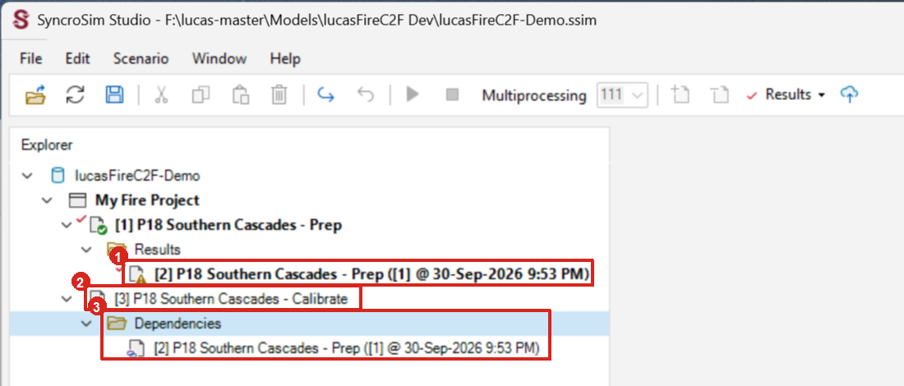

*Dependencies: (1) the Prep result; (2) the new Calibrate scenario; (3) its Dependencies folder, listing the Prep result.*

> **Depend on the result, not the Prep scenario.** The result holds the outputs P1-P5 wrote; the Prep scenario \[1\] itself has only its settings. If you rerun Prep, the new result is a new scenario: remove the old dependency and add the new one.

### 4.3 Replace the inherited pipeline

A dependency passes on **every** sheet of the result it points to, the pipeline included. A sheet that comes from a dependency is greyed out, with **Inherit values from '\[2\] ...'** ticked below it. That is what Calibrate wants for the data sheets (landscape maps, ignition surfaces, daily weather, wind table), but not for the pipeline: inherited, Calibrate would rerun P1-P5.

1. Open the Calibrate scenario (double-click it) and, on the **General** tab, select **Pipeline**. It shows Prep's five stages, greyed out.

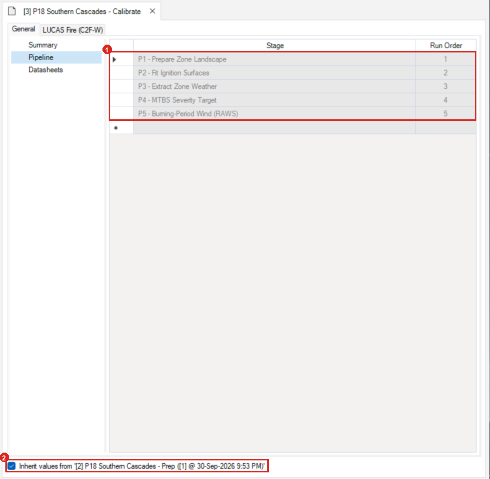

*The inherited pipeline: (1) Prep's stages, greyed because they come from the dependency; (2) the Inherit values box, ticked.*

2. Untick **Inherit values from '\[2\] P18 Southern Cascades - Prep ...'**.
3. Studio asks what to start from. Click **No Data**, for an empty pipeline. (Copy Data would copy Prep's five stages into Calibrate's own pipeline, to edit.)

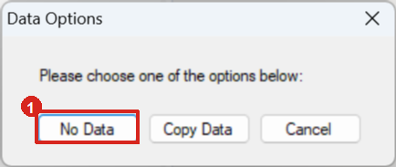

*Breaking inheritance: (1) No Data starts the sheet empty.*

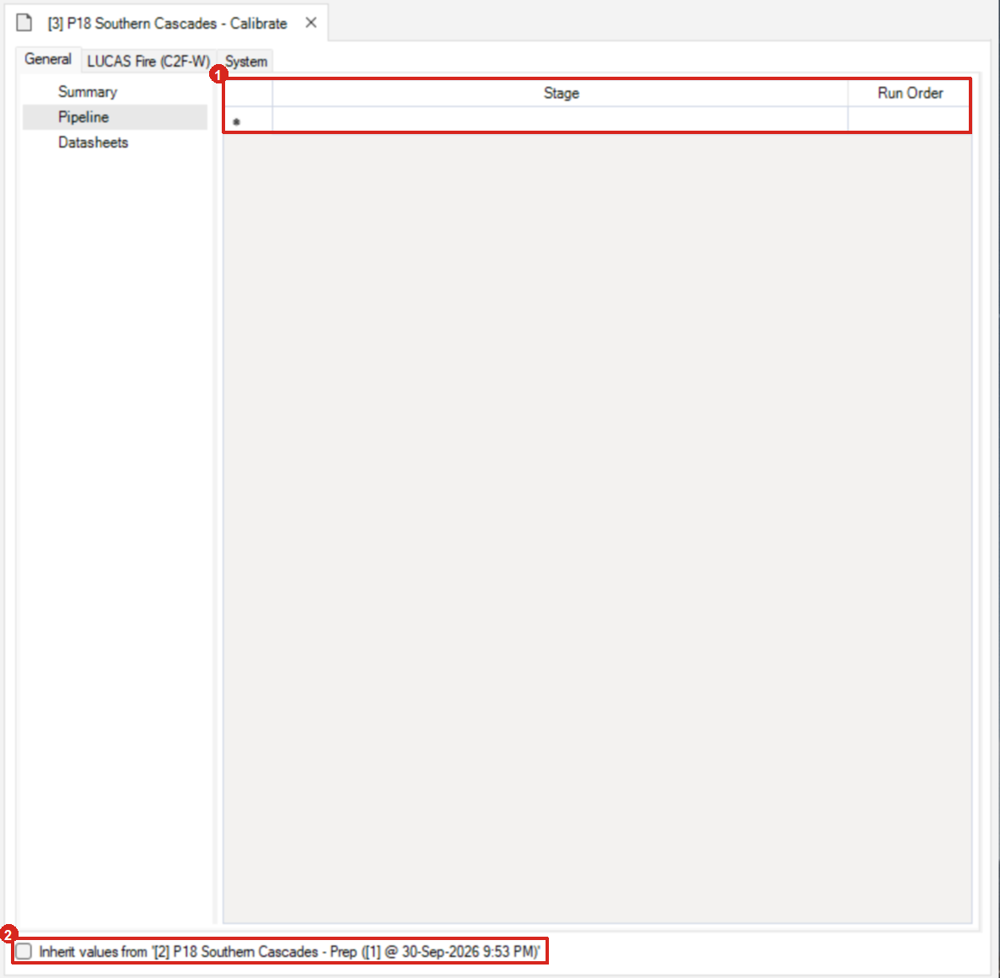

*The pipeline after No Data: (1) empty and editable; (2) Inherit values unticked.*

4. Add the ten Calibrate stages in order, as in 3.2: choose each from the Stage list on a new row.

| Run order | Stage | Does |
| --- | --- | --- |
| 1 | C1 - Import Fire Record | Reads the FPA-FOD fires inside the zone into the Historical Fire Record |
| 2 | C2 - Build Weather Stream | Computes fire-weather indices for every day of the Daily Weather and keeps the days fire can spread on |
| 3 | C3 - Fit Ignitions | Fits fires per season (Ignition Count) and their share by season and cause (Ignition Distribution) |
| 4 | 1 - Prepare Landscape | Builds C2F-W's landscape: fuels after the recent-fire rules, canopy, elevation |
| 5 | 2 - Sample Ignitions | Draws each season's fires and where they start |
| 6 | 3 - Sample Burning Conditions | Gives each fire its spread days, weather and fuel moisture |
| 7 | 4 - Grow Fires (C2F-W) | Burns every fire with C2F-W |
| 8 | 5 - Summarize Burn Probability | Fire sizes and the burn-probability map |
| 9 | C5 - Fit Spread Days | Fits the spread-day distribution to the recorded fire sizes |

5. Click outside the grid so the last row is committed, then save (Ctrl+S).

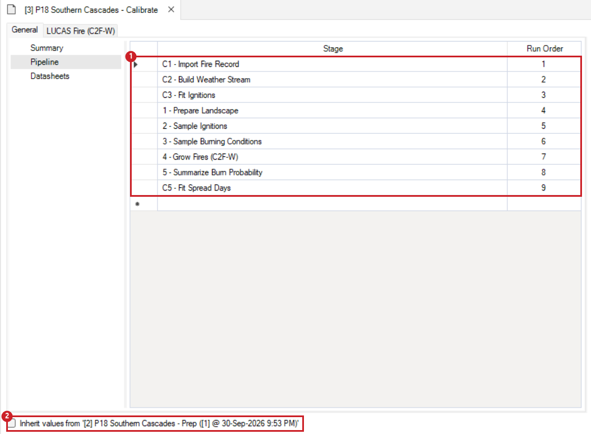

*Calibrate's own pipeline: (1) the nine stages in run order; (2) Inherit values stays unticked.*

> **Only the pipeline is unticked.** Leave every other sheet inheriting from the Prep result. Breaking inheritance on a data sheet such as Landscape Maps would leave Calibrate without the zone's maps. The same applies to the Run scenario in chapter 5.

### 4.4 Calibration settings

On the Calibrate scenario's **LUCAS Fire (C2F-W)** tab the tree now shows the sheets of all nine stages. Most keep their defaults or come from the Prep result. Set these five, saving after each: Run Control, Calibration Period, Calibration Options (this section), Burning Hours per Spread Day and Fire Growth Options (4.5).

#### Run Control

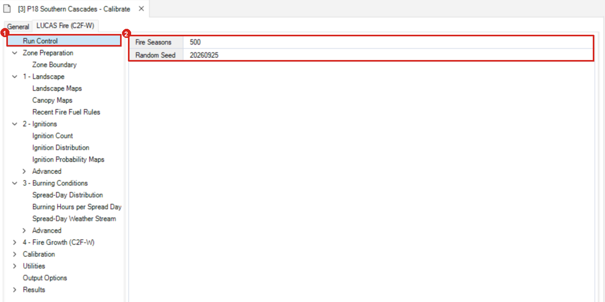

*Run Control: (1) the sheet, at the top of the tree; (2) Fire Seasons and Random Seed.*

| Field | P18 value | Notes |
| --- | --- | --- |
| Fire Seasons | 500 | How many seasons the seed run simulates (below) |
| Random Seed | 20260925 | The default. The same seed and settings give the same fires; change it only to test how much results vary |

**How many seasons.** What counts is seed fires per spread-day curve, not seasons. The seed run burns each fire for a random 1 to 25 days, and C5 uses those fires as samples of how big a fire grows in a given number of days. About 1,000 to 2,000 seed fires per curve has been enough for every pyrome so far. Work the seasons out from the zone's large fires per season, which C3 reports (the `ignition count: ... Gamma mean` line):

> seasons ≈ 1,500 × number of curves ÷ large fires per season

| Zone | Large fires per season | Curves | Seasons | Seed fires per curve |
| --- | --- | --- | --- | --- |
| P26 Northern Sierra Nevada | 10.9 | about 10 (cause x vegetation) | 1,500 | about 1,600 |
| P29 Northern Sierran Foothills | 16.1 | about 9 | 1,500 | about 2,700 |
| P18 Southern Cascades | 3.4 | 1 | 500 | about 1,700 |

You do not know a new zone's fires per season before the first Calibrate run. Start with 500 seasons for one curve; C3's log line then tells you whether that was enough. Seed fires are cheap: P18's 500 seasons grew in under 4 minutes.

#### Calibration Period

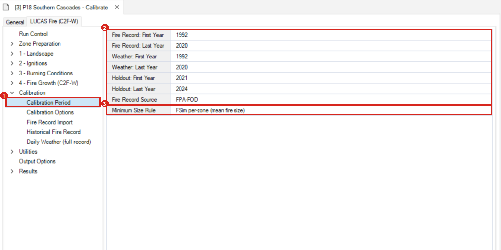

*Calibration Period: (1) the sheet under Calibration; (2) the years and record source; (3) Minimum Size Rule, changed from the default.*

| Field | P18 value | What it does |
| --- | --- | --- |
| Fire Record: First / Last Year | 1992 / 2020 | The FPA-FOD years the fit is matched to |
| Weather: First / Last Year | 1992 / 2020 | The days the spread-day weather stream (C2) draws from, the same years as the fires |
| Holdout: First / Last Year | 2021 / 2024 | Years kept out of the fit. No stage reads them yet; they record which years were held back |
| Fire Record Source | FPA-FOD | Which source in the Historical Fire Record to fit to (2.13) |
| Minimum Size Rule | **FSim per-zone (mean fire size)** | Which fires count as "large" in the fit (below) |

**Minimum Size Rule.** Only fires above a size threshold are simulated and fitted; smaller ones barely affect burn probability. *Fixed* uses one threshold everywhere (Fire Resampling's Minimum Fire Size, 36.8 ha). *FSim per-zone* follows FSim: the threshold is the zone's mean fire size over the calibration years, with a floor of 29.5 ha (73 acres). Use FSim per-zone, as for every pyrome so far; C3 logs the threshold it chose.

#### Calibration Options

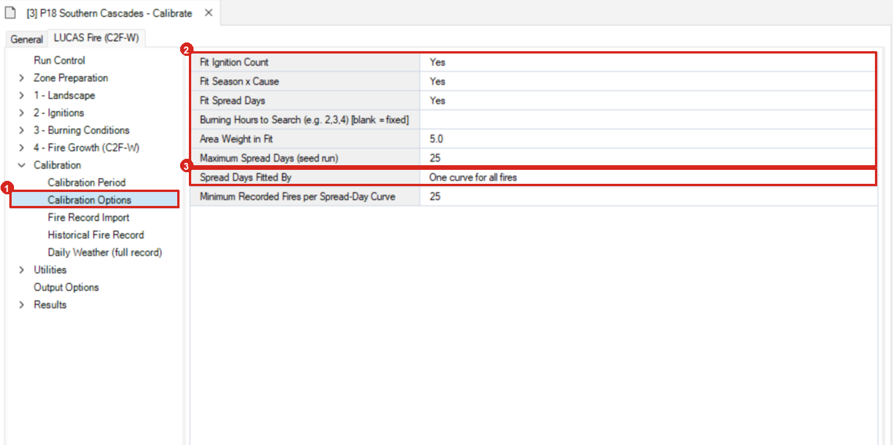

*Calibration Options: (1) the sheet under Calibration; (2) the fit switches and weights, left at their defaults; (3) Spread Days Fitted By, set to one curve for all fires.*

| Field | P18 value | What it does |
| --- | --- | --- |
| Fit Ignition Count | Yes | C3 fits fires per season (Gamma mean and SD) |
| Fit Season x Cause | Yes | C3 fits each season's and cause's share of fires |
| Fit Spread Days | Yes | C5 fits the spread-day distribution |
| Burning Hours to Search | blank | Blank uses the fixed Burning Hours per Spread Day. A list such as 1,2,4 makes C5 try each and keep the best fit |
| Area Weight in Fit | 5.0 | How strongly C5 also matches total area burned, not only the size distribution |
| Maximum Spread Days (seed run) | 25 | The longest a seed fire burns |
| Spread Days Fitted By | **One curve for all fires** | One curve, by cause, by origin vegetation, or by both |
| Minimum Recorded Fires per Spread-Day Curve | 25 | Only used when fitting several curves |

**One curve or several.** Separate curves let human and lightning fires, or fires in timber and shrub, burn for different numbers of days. Each curve needs enough recorded large fires to fit. P18 has few large fires (32 of 405 ha or more inside the pyrome, 1992-2020), too few to split, so it uses one curve for all fires.

### 4.5 Fire growth settings

#### Burning Hours per Spread Day

Under **3 - Burning Conditions**, select **Burning Hours per Spread Day**. It sets how many hours C2F-W burns each fire on each of its spread days. Type **2** in the Hours cell and press Enter, so the row is committed (a plain row marker, with a new empty row marked \* below it), then save.

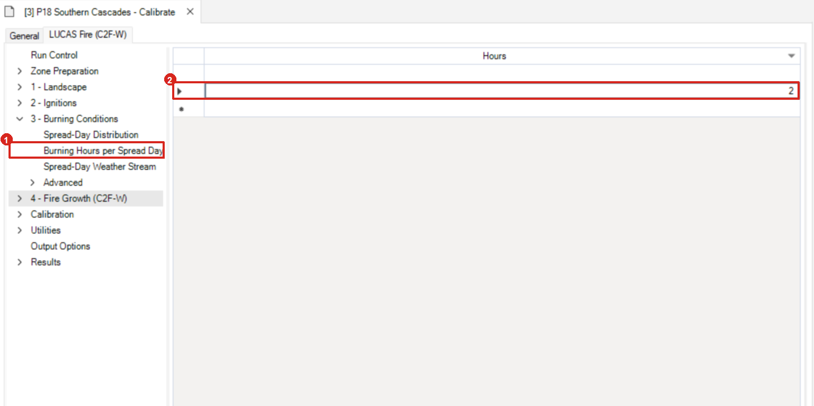

*Burning Hours per Spread Day: (1) the sheet under 3 - Burning Conditions; (2) the committed row, 2 hours, with the empty new-row line (\*) below it.*

A row with no Season applies to every season. Burning hours and the spread-day distribution trade off: fewer hours per day needs more days for the same fire size. C5 fits the days for the hours set here, so the hours are a modelling choice, not a fitted value. The Sierra pyromes settled on 2 hours for the forested P26 and 1 hour for the grass-dominated foothills (P29), where 2 hours could not make the many small and mid-size fires. P18 is mostly conifer forest, so it follows P26.

> **One row only.** Type the value and press Enter once. If an empty row is left behind and saved, copying the scenario turns it into a second row of 2 hours. Since version 2.3.0 stage 3 accepts identical rows, but keep the sheet to one row.

> An empty sheet runs on the package default (2 hours), but the row records the choice in the scenario.

#### Fire Growth Options

Under **4 - Fire Growth (C2F-W)**, select **Fire Growth Options**.

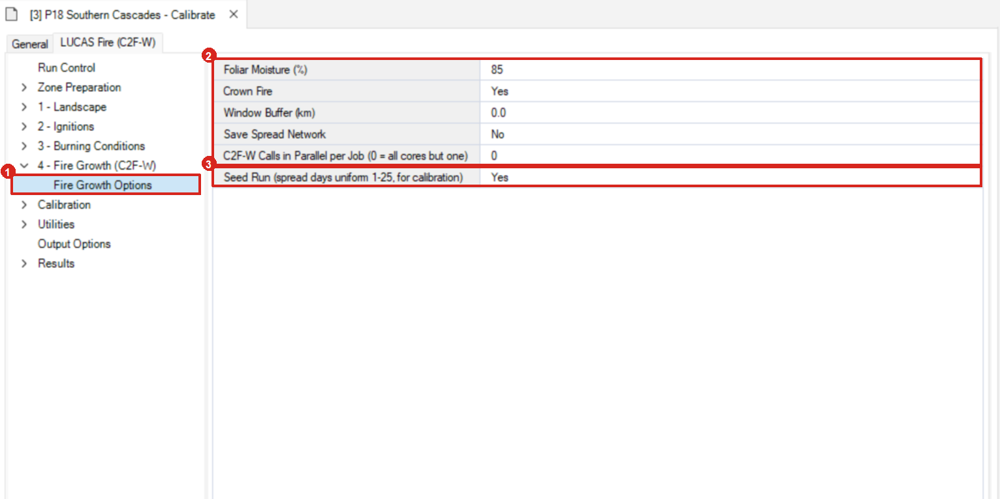

*Fire Growth Options: (1) the sheet under 4 - Fire Growth (C2F-W); (2) the growth settings; (3) Seed Run, the switch that makes this a calibration run.*

| Field | P18 value | What it does |
| --- | --- | --- |
| Foliar Moisture (%) | 85 | Live foliar moisture for crown-fire initiation |
| Crown Fire | Yes | Lets fires torch and crown (active crown fire also needs canopy cover of at least 40%) |
| Window Buffer (km) | 0.0 | Default; leave it |
| Save Spread Network | No | Saves which cell lit which; only needed for fire-path analysis, and it is large |
| C2F-W Calls in Parallel per Job | 0 | 0 runs C2F-W on all cores but one |
| **Seed Run** | **Yes** | Each fire burns a random 1 to 25 days instead of drawing from a spread-day distribution: the raw material C5 fits from |

> **Seed Run is Calibrate only.** The Run scenario (chapter 5) sets it back to No, so fires draw their spread days from the distribution C5 fitted.

### 4.6 Sheets left at their defaults, and the description

Every other sheet on the tab either comes from the Prep result (Landscape Maps, Canopy Maps, Ignition Probability Maps, Daily Weather, the wind table) or is written by this run (Historical Fire Record, Ignition Count and Distribution, Spread-Day Weather Stream, Spread-Day Distribution). One deserves a note: **Recent Fire Fuel Rules** is empty, and with a fire-age map from P1 an empty sheet applies the package's recent-fire rules (see Recent-fire rules in the methods paper); fill it only to change them.

Now describe the scenario. Open **General**, **Summary** and paste into Description:

```
P18 Southern Cascades - Calibrate: seed run and spread-day fit for pyrome 18. DEPENDS ON: [2] P18 Southern Cascades - Prep result. PIPELINE: C1 Import Fire Record, C2 Build Weather Stream, C3 Fit Ignitions, stages 1-5 (seed run), C5 Fit Spread Days; pipeline not inherited. RECORD: FPA-FOD 1992-2020, weather 1992-2020, holdout 2021-2024; minimum size rule FSim per-zone (zone mean fire size, floor 29.5 ha). FIT: ignition count and season x cause fitted; spread days fitted as one curve for all fires (too few large fires in P18 to split by cause or vegetation); area weight 5; burning hours 2 per spread day (as P26, forest pyrome). SEED RUN: 500 seasons, spread days uniform 1-25, seed 20260925. GROWTH: crown fire on, foliar moisture 85%, all cores but one. RECENT-FIRE RULES: package defaults.
```

Save (Ctrl+S).

### 4.7 Run Calibrate and read the fit

Run the Calibrate scenario as in 3.5: select it, click **Run**, answer **Yes** to the save prompt. P18's run took 11 minutes; the result appears as **\[4\] P18 Southern Cascades - Calibrate (\[3\] @ ...)**. Open its **Run Log** and check each stage. The fit itself is also kept in two of the result's sheets, under Results (below).

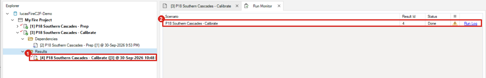

*The finished Calibrate run: (1) result \[4\] in the scenario's Results folder; (2) the Run Monitor row, Status Done, with the Run Log link.*

| Stage | Log line (P18) | What it tells you |
| --- | --- | --- |
| C1 | `imported 6,921 FPA-FOD fires inside the zone boundary, 1992-2020 (98 >= 29.5 ha ...)` | The whole record is imported; only the large fires are fitted. Here 98 in 29 years |
| C2 | `spread-day stream: 136,037 days with FWI >= 19 ... summer median FWI 49.9, BUI 219.8` | Days hot and dry enough to spread fire, per weather zone and season. A summer BUI in the hundreds is right for California; values under about 20 mean the fire-weather codes did not accumulate |
| C3 | `large-fire threshold 29.54 ha (FSim rule: mean fire size, 73-ac floor)` | P18's mean fire size is 15.9 ha, below the floor, so the 29.5 ha floor applies |
| C3 | `ignition count: 98 fires >= threshold, Gamma mean 3.379 SD 2.611 per season (range 0-10)` | Large fires per season: the number that sets how many seasons the seed run needs (4.4) |
| C3 | `season x cause: ... Summer/Human 0.439; Summer/Lightning 0.439 ...` | 88% of large fires start in summer, split evenly between people and lightning |
| 1 | `Recent Fire Fuel Rules is empty: using the package defaults (0-2 yr -> NB9, 3-5 yr -> TL1, 6-10 yr -> TL8)` | Recently burned cells: 53,888 made unburnable, 34,416 and 36,393 given litter fuels |
| 1 | `sent to C2F-W as TL5: TL4 (72,935 cells)` and similar | The fuel remaps of 2.3 at work |
| 2 | `500 seasons: 1,744 fires (mean 3.49 per season)` | The seed fires drawn |
| 4 | `done in 3.7 min: 14,679,335 burned cells` | C2F-W's share of the run |
| 5 | `kept 1,703 fires (3.41 per season); 2.4% of season fires below 29.5 ha replaced` | Fires that came out smaller than the threshold are replaced from a pool of extra ignitions or, in a seed run (no pool), dropped; only large fires are fitted |
| C5 | `Any / Any: 98 recorded fires, mean 1103 ha; fitted KS 0.069, mean kept size / observed 1.00, mean spread days 2.43` | The fit (below) |

#### Reading the C5 fit

C5 finds the mix of spread days whose seed fires reproduce the recorded fire sizes. Three numbers say how well:

- **KS**: the largest gap between the simulated and recorded cumulative size distributions. Lower is better; as a rule of thumb, under about 0.10 is a good fit. P18's is 0.069.
- **mean kept size / observed**: simulated mean fire size over the recorded mean. P18's 1.00 means area burned per fire matches.
- **mean spread days**: P18's fires burn 2.43 days on average.

Below them C5 prints the fitted curve and the size classes:

| Size class (ha) | Recorded share | Fitted share |
| --- | --- | --- |
| 29.5-100 | 0.378 | 0.403 |
| 100-405 | 0.286 | 0.238 |
| 405-1,000 | 0.133 | 0.164 |
| 1,000-3,000 | 0.122 | 0.106 |
| 3,000-10,000 | 0.051 | 0.065 |
| 10,000-30,000 | 0.031 | 0.022 |
| 30,000 and over | 0.000 | 0.002 |

Every class is within a few points of the record. The model makes a few fires over 30,000 ha, which the 1992-2020 record lacks; the 2021 Dixie Fire, outside the calibration years, shows they happen here.

> **A spiky curve is normal.** P18's curve puts 0.56 on 1 day, 0.07 on 2, 0.24 on 3, nothing on 6 or 8, and small weights out to 14 days. The fit mixes a few day-values to match the size classes; with about 100 recorded fires, many different mixes fit almost equally well, so the weights jump between neighbouring days. Judge the fit by KS, the size ratio and the size classes, not by the curve's shape. The Sierra pyromes' curves look the same.

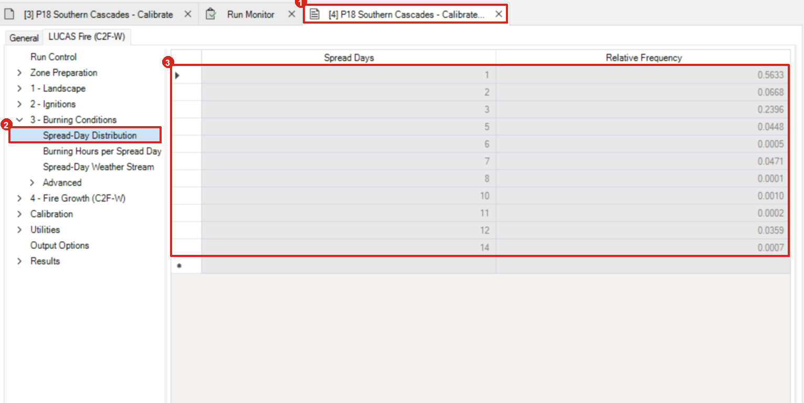

*The fitted curve: (1) result \[4\] opened in its own tab (double-click it in the Explorer); (2) Spread-Day Distribution under 3 - Burning Conditions; (3) the relative frequency of each spread-day value. The rows are greyed because a result's sheets are read-only.*

The fitted curve is written to this result's **Spread-Day Distribution** sheet. The Run scenario takes it from there by depending on this result (chapter 5).

**Where the fit is kept.** Open the Calibrate result and, under **Results**, two sheets hold what C5 found:

| Sheet | What it holds | P18 result 4 |
| --- | --- | --- |
| Calibration: Fit Summary | Burning Hours, Max CDF Gap (KS), Area Ratio and Mean Spread Days, one row per spread-day curve | 2 h, KS 0.069, area ratio 1.00 |
| Calibration: Size Distribution Fit | Observed and fitted share of fires in each size class (the table above) |  |

**Scores Against Fire Records stays empty here, by design.** C5's numbers come from reweighting the seed fires, so they show how well the curve can fit, not what the model does with it. Use them as a gate: if KS is well over 0.10, the area ratio far from 1 or a whole size class missed, the check run will not do better, so fix the fit first (4.4, 4.5). The check is the Run scenario (chapter 5): it grows new fires with the fitted curve, and C6 scores them against the record (5.6). If those scores hold, the same Run scenario with more seasons is the finished model (6.4); the only differences are the number of seasons and the random draws.

## 5. Run the model (Run)

The Run scenario is the burn-probability model itself. It simulates thousands of fire seasons with the fitted spread days and turns them into the zone's maps: burn probability (stage 5), flame length and crown fire (6), hazard and risk (7), and optionally per-fire detail (8). Then it scores the result against the fire record (C6) and validates the burn-probability map (C7).

### 5.1 Create the scenario and add two dependencies

1. Create a scenario named `P18 Southern Cascades - Run`, as in 4.1.
2. Drag the **Calibrate result \[4\]** onto it, then the **Prep result \[2\]**, as in 4.2.

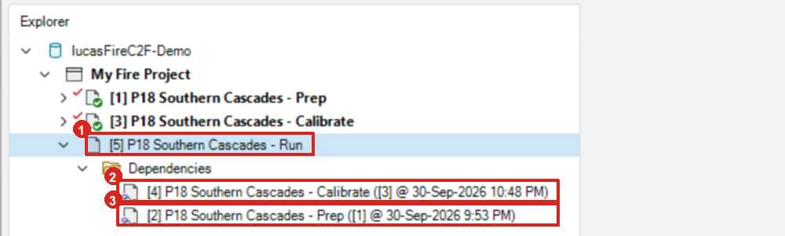

*The Run scenario: (1) the new scenario; (2) the Calibrate result, which supplies the fitted ignition count, season and cause shares, spread-day weather stream, spread-day distribution and burning hours; (3) the Prep result, which supplies the landscape maps, ignition surfaces, daily weather, severity target and wind table.*

The two results hold mostly different sheets. Where both carry a sheet, the dependency listed first wins: the Inherit box on such a sheet names the Calibrate result. The sheets both carry (the pipeline, Run Control, Fire Growth Options) are the ones Run sets for itself in 5.2 to 5.4, so add Calibrate first and Prep second, as here.

### 5.2 The Run pipeline

As in 4.3: on **General**, **Pipeline**, untick **Inherit values from '\[4\] ...'**, choose **No Data**, and add the ten Run stages in order.


*The Run pipeline: (1) the ten stages in run order; (2) Inherit values unticked, naming the Calibrate result, the first dependency.*

| Run order | Stage | Does |
| --- | --- | --- |
| 1 | 1 - Prepare Landscape | C2F-W's landscape, as in Calibrate |
| 2 | 2 - Sample Ignitions | Each season's fires and origins, from the fitted count and surfaces |
| 3 | 3 - Sample Burning Conditions | Spread days from the fitted distribution, weather and fuel moisture |
| 4 | 4 - Grow Fires (C2F-W) | Burns every fire |
| 5 | 5 - Summarize Burn Probability | Burn probability and burn count maps |
| 6 | 6 - Fire Effects | Flame length, flame-length classes and crown fire per cell |
| 7 | 7 - Hazard and Risk | High-intensity burn probability and risk to potential structures |
| 8 | 8 - Fire Detail (optional) | Per-fire perimeters, hourly weather and severity maps; leave it out for a quicker run |
| 9 | C6 - Score Against Fire Records | Simulated fire sizes and counts against the record, including the 2021-2024 holdout |
| 10 | C7 - Validate Burn Probability | The burn-probability map against where fires actually burned, and against WRC |

### 5.3 Turn the seed run off

Run inherits **Fire Growth Options** from the Calibrate result, Seed Run included. Left on, every fire would burn a random 1 to 25 days and ignore the fitted curve.

1. On the **LUCAS Fire (C2F-W)** tab, under **4 - Fire Growth (C2F-W)**, select **Fire Growth Options**.
2. Untick **Inherit values from '\[4\] ...'** and choose **Copy Data** this time: it keeps the inherited growth settings, now editable.
3. Set **Seed Run** to **No** and save.


*Fire Growth Options in Run: (1) the sheet; (2) Seed Run set to No; (3) Inherit values unticked.*

> **No Data or Copy Data?** No Data starts the sheet empty; Copy Data copies what was inherited so you can change one value. Use No Data for lists you replace whole (the pipeline), Copy Data for option sheets you adjust.

### 5.4 Run Control

Under **Run Control**, untick Inherit as above (Copy Data) and set **Fire Seasons** to **2500**, the package default. Keep the random seed.


*Run Control in Run: (1) the sheet; (2) 2,500 seasons and the seed; (3) Inherit values unticked.*

The Run scenario estimates how often each cell burns, so it needs many more seasons than the seed run. Each 150 m cell burns only once in many decades; 2,500 seasons give enough burns per cell for a stable map. At P18's 3.4 large fires per season that is about 8,500 fires.

Every other sheet keeps inheriting: from the Calibrate result the fitted ignition count, season and cause shares, spread-day distribution, burning hours and weather stream; from the Prep result the maps, ignition surfaces, severity target and wind table. The effects, risk and validation options (stages 6, 7, C7) run on their package defaults.

### 5.5 Describe and run

Paste into **General**, **Summary**, **Description**, save, and run as in 3.5:

```
P18 Southern Cascades - Run: burn probability, fire effects and risk for pyrome 18. DEPENDS ON: [4] P18 Southern Cascades - Calibrate result (fitted ignition count, season x cause, spread-day weather stream, spread-day distribution, 2 burning hours) and [2] P18 Southern Cascades - Prep result (landscape, ignition surfaces, daily weather, severity target, wind table). PIPELINE: stages 1-8, C6 Score Against Fire Records, C7 Validate Burn Probability; pipeline not inherited. RUN: 2,500 seasons, seed 20260925; seed run off (fitted spread days). GROWTH: crown fire on, foliar moisture 85%, all cores but one. OPTIONS: effects, risk and validation at package defaults; WRC benchmark from Data Sources.
```

### 5.6 Read the Run results

P18's Run took 21 minutes for 2,500 seasons: 10 minutes growing 12,985 fires (8,657 season fires plus a pool of 4,328 extra ignitions, from which stage 5 replaces fires that stayed under the size threshold), and 1 to 2 minutes for each later stage. The result appears as **\[6\] P18 Southern Cascades - Run (\[5\] @ ...)**. Its log has three parts worth reading closely.

#### Fire sizes and counts (C6)

C6 compares the simulated fires with the record, by size class, by cause and by origin vegetation, over the calibration years:

| Size class (ha) | Fires/yr observed | Fires/yr simulated | Area observed (ha/yr) | Area simulated (ha/yr) |
| --- | --- | --- | --- | --- |
| 30-100 | 1.28 | 1.39 | 67 | 81 |
| 100-405 | 0.97 | 0.94 | 227 | 209 |
| 405-1,000 | 0.45 | 0.54 | 271 | 348 |
| 1,000-3,000 | 0.41 | 0.34 | 740 | 588 |
| 3,000-10,000 | 0.17 | 0.17 | 917 | 944 |
| 10,000-30,000 | 0.10 | 0.07 | 1,506 | 1,009 |
| 30,000 and over | 0.00 | 0.01 | 0 | 341 |
| **Total** | **3.38** | **3.46 (1.02x)** | **3,727** | **3,519 (0.94x)** |

The totals are what the calibration aimed at: fires per year within 2% and area within 6%. Classes are within about 20%, except the largest recorded class, which is short. Whether such gaps matter is what the noise test below decides.

**Is the calibration acceptable?** Since version 2.4.0, C6 judges every test against the noise of a record as short as the real one. A 29-year record is one draw of 29 seasons. C6 draws 1,000 sets of 29 seasons from the run itself and scores each set as it scores the record. The middle 90% of those draws is the **model range**: where a 29-year record would fall by chance if the model were right. The sheet's last three columns give the range and a verdict:

| Verdict | The record falls | What to do |
| --- | --- | --- |
| within noise | inside the 90% range | Nothing: the record cannot tell this apart from the model |
| check | outside the 90% range, inside the 99% range | Look at it; about 1 test in 10 lands here by chance alone |
| poor | outside the 99% range | The model and the record disagree; revisit the fit (chapter 4) |

C6 also draws the figure below, **Fig6\_fire\_sizes.png**, so every scored run carries it without stage R. The whiskers on the model's bars and the band in panel (c) are the 90% model range; any class outside it is labelled. The title counts the verdicts.

**Where to find it.** The figure belongs to the Run result, not the Run scenario:

| Where | How |
| --- | --- |
| Studio | Open the Run result (double-click it in the Explorer), then on the **LUCAS Fire (C2F-W)** tab choose **Results**, **Report Figures**. The row named Fire sizes and calibration holds the PNG |
| Export tab | Select the Run result, open the **Export** tab and export **Report Figures** to a folder of your choice (6.3) |
| On disk | `<library>.ssim.data\Scenario-<result id>\lucasFireC2F_OutputReportFigure\Fig6_fire_sizes.png`. For the example below: `F:\lucas-master\Models\lucasFireC2F Dev\lucasFireC2F-Demo.ssim.data\Scenario-26\lucasFireC2F_OutputReportFigure\Fig6_fire_sizes.png` |

The same numbers are in the result's **Scores Against Fire Records** sheet (columns Model Range: Low, Model Range: High and Record vs Model Range) and at the end of C6's lines in the Run Log. The sheet and the log also hold the by-cause and by-vegetation tests, which the figure does not draw.


*P18's check run (result 26): 37 of 39 tests within noise. The two misses are shrub-origin fires: 170 ha a year simulated against 2 recorded (check), and a mean size of 1,187 ha against 35 (poor). The 10,000-30,000 ha area bar looks short, but a 29-year record of that class varies from 0 to 2,480 ha a year under this model, so the record's 1,506 ha is well inside. For contrast, the seed run scored the same way gets 19 of its 25 size and cause tests poor.*

**Reading the P18 example.** The calibration passes:

- **Title.** 37 of 39 tests within noise, 1 check, 1 poor. Both misses are in the sheet, not the figure: shrub-origin fires (below).
- **(a) Fires by size class.** Every recorded bar sits inside the model's whisker, and the totals agree (3.38 fires a year recorded, 3.46 simulated). The fire count is what C3 fitted, so this panel mostly confirms the ignitions.
- **(b) Area by size class.** The biggest gap is 10,000-30,000 ha: 1,506 ha a year recorded against 1,009 simulated. The whisker runs from 0 to 2,480 ha, because three fires in 29 years cannot pin that class down. The model also burns 341 ha a year in fires over 30,000 ha, which the 1992-2020 record lacks. It goes 29 years without one often enough for that to be within noise, and the 2021 Dixie Fire shows such fires happen here.
- **(c) Fire size exceedance.** The recorded fires stay inside the band at every size. Above about 1,000 ha they run along its upper edge, so the record's large fires are a little bigger than the model's, though not beyond chance. The band drops to the axis past about 7,000 ha because many 29-year draws contain no fire that large.
- **(d) Spread days.** The fitted curve (mean 2.43 days, 56% of fires burning one day) is the one read in 4.7; it is drawn here so the figure is a complete record of the calibration.
- **What the sheet adds.** Shrub-origin fires average 1,187 ha in the model against 35 ha for the two recorded (poor), and burn 170 ha a year against 2 (check). With one curve for all fires, shrub-origin fires get the same spread days as timber fires. That is a known limit of this P18 setup (see By origin vegetation below), not a reason to reject the calibration.

In a zone where several size classes or the exceedance points fall outside the range, go back to chapter 4: check the in-sample fit, the burning hours and how the spread days are stratified.

Accept the calibration when the tests are within noise, with at most a scattered check. The verdicts say what the record can resolve, not that the model is right: in a small zone the ranges are wide, so a passing score is weak evidence.

**By cause**, simulated human fires burn 1.77 times their recorded area and lightning fires 0.59 times: recorded lightning fires average 1,652 ha against 652 ha for human fires, while one spread-day curve gives both causes the same days. The noise test still marks both within noise: under this model a 29-year record of lightning area ranges from 560 to 2,610 ha a year, so the gap may be chance. It may also be the cost of fitting one curve. With enough large fires, a curve per cause (Spread Days Fitted By: Cause) would separate them. **By origin vegetation**, the shrub and hardwood rows rest on a few recorded fires; the noise test finds hardwood within noise but marks shrub poor: the model's shrub-origin fires average 1,187 ha against 35 recorded, too large even for so few fires.

#### Fire behaviour (stage 6)

Stage 6 reports the burns by fuel group: share of burns, crown fire, active crown fire, the probability of flame length over 4 and 8 ft (FLEP4, FLEP8), and the conditional mean flame length (CFL).

| Fuel group | Share of burns | Crown | Active | FLEP4 | FLEP8 | CFL (ft) |
| --- | --- | --- | --- | --- | --- | --- |
| Timber-Understory | 36.7% | 8% | 3% | 0.10 | 0.04 | 6.6 |
| Grass-Shrub | 23.7% | 1% | 0% | 0.01 | 0.00 | 1.3 |
| Timber Litter | 18.3% | 0% | 0% | 0.00 | 0.00 | 1.4 |
| Grass | 12.7% | 0% | 0% | 0.03 | 0.00 | 1.9 |
| Shrub | 8.6% | 12% | 0% | 0.36 | 0.10 | 4.5 |
| All | 100% | 4% | 1% | 0.07 | 0.02 | 3.6 |

Most burns are low-intensity surface fire. Timber-understory fuels carry nearly all the crown fire. The line `active crown fire needs canopy cover >= 40%: 35,835 burn events ... stay passive` is the canopy-cover rule at work. Stage 7 then reports the zone's risk to potential structures: a mean conditional loss (cRPS) of 29% if a cell burns, and the RPS class edges.

**Stage 8** fits the severity class thresholds the first time it runs on a zone (`Severity Class Thresholds are empty: fitting them on this run`), so the simulated MTBS-style severity matches the target from P4. Keep those thresholds fixed for later scenario runs, as the log says. For P18 the target is effectively the 2021 fire year (3.6).

#### Spatial skill (C7)

C7 asks whether the burn-probability map ranks the ground where large fires (MTBS, 405 ha and over) actually burned above the ground they missed, and compares that with WRC's burn probability on the same cells.

| Fires | Ground burned | AUC model | AUC WRC | Hottest decile model | Hottest decile WRC |
| --- | --- | --- | --- | --- | --- |
| 1984-2010 | 6.1% | 0.756 | 0.730 | 32% | 25% |
| 2021-2024 | 20.2% | 0.422 | 0.489 | 4% | 16% |
| 1984-2024 | 28.5% | 0.484 | 0.531 | 10% | 14% |

**AUC** is the chance that a randomly chosen burned cell has a higher burn probability than a randomly chosen unburned one: 0.5 is no skill. **Hottest decile** is the share of the burned ground that fell in the map's top 10% of cells; 10% is no skill.

Over 1984-2010, P18's map beats WRC on both measures. In 2021-2024 both maps score below 0.5: a fifth of the zone burned in those four years, almost all of it in the 2021 Dixie Fire, through ground both maps rate low. A few very large fires decide any post-2020 score, so judge a model by the long record, by fires per year and area, and against WRC, not by the most recent years alone. The `selection` lines below the table compare how the observed fires favoured fuels, time since fire, elevation and the zone's thirds with how the map does; for 2021-2024 they mostly describe where Dixie went.

> **This is a working model, not a finished one.** The P18 built in this guide reproduces the zone's fire numbers and sizes and has long-record skill above WRC, with one spread-day curve and package defaults throughout. Chapter 7 covers the levers for improving a zone: a curve per cause, the burning hours, and the ignition fit.

## 6. View and export the maps

The Run result holds the zone's maps: burn probability and burn count (stage 5), the fire-effects maps (6), the hazard and risk maps (7) and the severity maps by season (8). Studio draws them on its **Maps** tab and exports them as GeoTIFFs from the **Export** tab.

### 6.1 Make a map

1. In the Explorer, select the Run result **\[6\] P18 Southern Cascades - Run (...)**. A map draws one panel for every result that is ticked (the red tick beside the scenario); untick the Prep and Calibrate results (click the tick, or use the **Results** button on the toolbar) so only the Run result is drawn.
2. Below the Explorer, select the **Maps** tab and click **New** (the blank-page icon).


*Making a map: (1) the Run result, the only one ticked; (2) the Maps tab; (3) New.*

3. Name the map, for example `P18 burn probability`, and click **OK**.


4. The map opens in its own tab. In the tree at its left, expand **LUCAS Fire (C2F-W)** and tick **Burn Probability**. The map draws, with its legend under the ticked layer.


*A map in Studio: (1) the saved map in the Maps list, to reopen later; (2) Burn Probability ticked, with its legend; (3) the panel controls: iteration, identify, pan and zoom, and panel size; (4) the map panel, one per ticked result; (5) Options and Apply.*

The legend is the annual probability that a cell burns. P18's ranges up to 0.0156, about 1.6% a year, or once in 64 years, in the hottest cells in the centre of the zone; most of the zone is under 0.3% a year (deep blue), once in more than 300 years. The map covers the zone and its 25 km buffer. Fires start only inside the pyrome (the ignition surfaces are zero outside it), so buffer cells burn only where those fires spread out; grey cells never burned in 2,500 seasons.

The tree also holds the other maps: **Burn Count** (times each cell burned in the 2,500 seasons), **Fire Effects** (flame length, the flame-length classes and crown fire, 6), **Hazard and Risk** (high-intensity burn probability and risk to potential structures, 7), **Severity by Season** (stage 8's severity maps for the first ten seasons) and **Inputs** (the landscape maps the run used). Tick one layer at a time: each ticked layer adds a row of panels.

### 6.2 Effects and risk maps

In the same map, untick **Burn Probability**, expand **Hazard and Risk** (or **Fire Effects**) and tick one layer. Here, **Risk to potential structures, annual**: the expected percent loss per year to a structure standing in the cell (burn probability times the conditional loss, 2.12).


*Risk to potential structures, annual: (1) Hazard and Risk expanded; (2) the RPS layer ticked, with its legend in % loss per year; (3) the map.*

P18's annual risk reaches about 1.2% a year in the hottest cells. The map covers far less ground than the burn-probability map, and that is expected: the fire-effects maps, and the risk maps built on them, are drawn only where a cell burned at least **10 times** in the run (Effects Options, **Minimum Burns for Conditional Maps**). A flame-length probability or a conditional loss from two or three burns is mostly noise. In P18's 2,500 seasons a burned cell burned a median of 4 times, and only 13.5% of burned cells reached 10, so most of the zone has no conditional values.

> **For full effects and risk maps in a low-fire zone, run more seasons.** Coverage grows with burns per cell: 10,000 seasons give about four times as many, enough to fill most of the burned ground. Lowering Minimum Burns fills the map faster but with noisier values. Burn probability itself is unaffected: it is well estimated from 2,500 seasons. Section 6.4 adds a longer run to the P18 model without redoing Prep or Calibrate.

### 6.3 Export the maps

The maps live in the library as GeoTIFFs. To use them elsewhere (GIS, R, a report), export them:

1. Select the Run result in the Explorer (only the results ticked are exported).
2. Below the Explorer, select the **Export** tab.
3. Under **LUCAS Fire (C2F-W)**, **Maps**, select **Burn Probability Maps**, **Fire Effects Maps** or **Hazard and Risk Maps**.
4. Click **Open**, the export button at the top right of the tab, and choose a folder.


*Exporting maps: (1) the Export tab; (2) the three map exports; (3) Open, which starts the export.*

Each export writes every map of that group to the folder as GeoTIFFs in the model's projection (EPSG:5070, 150 m cells). **System**, **Scenario Descriptions** exports the description text of the selected scenarios, a record of how each was set.

### 6.4 Add a longer run to the model

A finished model can take more runs without redoing Prep or Calibrate: copy the Run scenario, change what differs, and run the copy. Here, 10,000 seasons to fill the effects and risk maps of 6.2.

1. Right-click **\[5\] P18 Southern Cascades - Run** and choose **Copy**.


*(1) The Run scenario (the scenario, not its result); (2) Copy.*

2. Right-click **My Fire Project** (or empty space in the Explorer) and choose **Paste**. The copy appears as **\[7\] P18 Southern Cascades - Run - Copy**.


*(1) Paste makes a full copy: settings, pipeline and dependencies, but not results; (2) Paste Special offers more choices, not needed here.*

3. Open the copy. On **General**, **Summary**, rename it `P18 Southern Cascades - Run 10,000` and update the description: the copy carries the original's, which still says 2,500 seasons.


*(1) The copy, \[7\], under the project; (2) the new name; (3) the description, to be edited: change RUN: 2,500 seasons to 10,000 seasons and say why (fills the conditional effects and risk maps).*

4. On the **LUCAS Fire (C2F-W)** tab, **Run Control**, set **Fire Seasons** to **10000**. The copy kept the original's own Run Control (Inherit is still unticked), so only this value changes. Save.


*(1) The copy; (2) Fire Seasons, 10,000; (3) Inherit unticked, and naming the Calibrate result: the copy kept both dependencies.*

Expand the copy in the Explorer to confirm: its **Dependencies** folder lists the same Calibrate and Prep results as the original.


*(1) The copy, Run 10,000; (2) its Dependencies, carried over from the original: the Calibrate result \[4\] first, the Prep result \[2\] second.*

5. Run the copy as in 3.5.

> **Copy, then change one thing.** The same pattern serves any variant of a finished zone: another random seed to see how much results vary, a different burning-hours value, a later fuel vintage (a new Prep result as the dependency). Each copy keeps its own description and results, so variants can be compared side by side on one map.

### 6.5 Where the data are stored

A library is one file plus a few folders beside it, all named after the library. For the demo, in `F:\lucas-master\Models\lucasFireC2F Dev`:

| Item | What it holds |
| --- | --- |
| `lucasFireC2F-Demo.ssim` | The library itself, a SQLite database: every setting, every table (the fire record, daily weather, fire lists and statistics, scores) and the paths of every map. P18's is 168 MB |
| `lucasFireC2F-Demo.ssim.data` | The files the tables point to: maps (GeoTIFF), large tables (Parquet), perimeters (GeoPackage) |
| `lucasFireC2F-Demo.ssim.temp` | Working space during runs; leave it to Studio |
| `lucasFireC2F-Demo.ssim.backup` | Backups made from Studio (File, Backup) |
| `lucasFireC2F-Demo.ssim.v210.bak` and similar | Copies saved before a package upgrade, named by the version they were made with |

Inside `.ssim.data`, one folder per scenario that holds files, named by its ID, and one per project:

| Folder | Holds |
| --- | --- |
| `Project-1` | The project's map colour settings |
| `Scenario-2` (Prep result) | The zone's landscape, canopy and ignition-probability maps and the zone boundary: 27 MB |
| `Scenario-4` (Calibrate result) | The seed run's engine landscape, burn table and burn probability: 218 MB |
| `Scenario-6` (Run result) | Everything stage 1 to 8 wrote: 279 MB |

Inside a scenario folder, one subfolder per datasheet, named `lucasFireC2F_` plus the sheet's internal name. For the Run result:

| Subfolder | Files |
| --- | --- |
| `lucasFireC2F_OutputBurnProbability` | `burn_probability.tif`: the burn-probability map |
| `lucasFireC2F_OutputBurnCount` | `burn_count.tif` |
| `lucasFireC2F_OutputFireEffects` | `effects_CFL.tif`, `effects_FLEP4.tif`, `effects_FLEP8.tif`, `effects_FLP1.tif` to `FLP6`, `effects_PCROWN.tif`, `effects_PACTIVE.tif`, `effects_CROWNBP.tif`, `effects_BURNS.tif` |
| `lucasFireC2F_OutputRisk` | `risk_HIBP.tif`, `risk_CRPS.tif`, `risk_RPS.tif`, `risk_RPSCLASS.tif` |
| `lucasFireC2F_OutputSeverityMap` | Stage 8's severity, fire-type and fire-ID maps, one per season |
| `lucasFireC2F_OutputFirePerimeter` | Every fire's perimeter (GeoPackage) |
| `lucasFireC2F_OutputBurnTable`, `lucasFireC2F_OutputBurnEffects` | Every burned cell of every fire, with its flame length and crown state (Parquet) |
| `lucasFireC2F_OutputEngineLandscape` | The fuel, canopy and elevation grids C2F-W burned |
| `lucasFireC2F_LandscapeRasters`, `_CanopyRasters`, `_IgnitionGrid` | The inputs this result used, copied from its dependencies |

A file name ending in `(2)` only means SyncroSim already had a file of that name in the library. The file names, the codes in them (CFL, RPS and so on) and the folders do not change between runs, so scripts can read them directly; to hand maps to someone else, use Export (6.3) rather than copying from here.

> **Do not edit, move or delete files inside `.ssim.data`.** The library records each file's path; a missing file breaks the result it belongs to. Delete results from Studio (right-click, Delete) and let it remove their files.

### 6.6 Report figures (stage R)

Studio's maps are for checking a run; the figures for a report come from stage **R - Report Figures (optional)**, added in version 2.3.0. It draws seven PNG figures on a shaded-relief base of the zone, in about 20 seconds:

| Figure | Shows | Needs |
| --- | --- | --- |
| Fig1 Model inputs | Fuel group, canopy bulk density, ignition probability | Stages 1-2 |
| Fig2 Burn probability | The model's burn probability beside WRC's, with the large MTBS fires after the fuel vintage outlined | Stage 5; WRC from Data Sources |
| Fig3 Fire intensity | Conditional flame length, FLEP4, FLEP8 | Stage 6 |
| Fig4 Crown fire | Crown and active crown fire when burning, annual crown-fire probability | Stage 6 |
| Fig5 Hazard and risk | High-intensity burn probability, conditional and annual risk to potential structures, risk class | Stage 7 |
| Fig6 Fire sizes | Fires and area by size class against the record with the noise of a record as long as the real one, size exceedance, spread-day distribution (C6 draws it too, 5.6) | C6 |
| Fig7 Validation | AUC and hottest-decile capture against WRC by period, fire effects by fuel group | C7, stage 6 |

A figure whose stage did not run is left out.

**In a Run scenario**, add **R - Report Figures (optional)** as the last stage of the pipeline:


*Stage R at run order 11, after C7. As always, click outside the grid to commit the row, then save.*

**For a result that already exists**, there is no need to rerun it: create a scenario (for example `P18 Southern Cascades - Report`), make the Run result its only dependency, give it a pipeline of stage R alone (untick Inherit, No Data, add the stage) and run it. It reads everything from the Run result.

The figures appear in the result under **Results**, **Report Figures**, where each opens in your image viewer, and on the **Export** tab under **Report Figures**, which writes them all to a folder.

Stage R also writes three small tables for Studio's **Charts** tab (fires and area by size class, the spread-day distribution, AUC by period). Studio charts against the timestep, so to see them set the chart's Timesteps box to the range of the data (1 to 7 for size classes). They are a quick look only; use the PNG figures for anything you show.

#### The P18 figures (Run 10,000)

The 10,000-season run with stage R added took 55 minutes and gave these figures. Compared with the 2,500-season run of 5.6: fires per year and area burned are unchanged (1.02 and 0.98 times the record), the effects and risk maps now cover most of the burned ground, and the map ranks the long-record fires better (AUC 0.813 for 1984-2010, against 0.756 at 2,500 seasons and 0.730 for WRC), probably because a longer run gives a smoother burn-probability surface.


*The P18 model's burn probability is lower than WRC's across most of the zone (zone mean 0.21 against 0.59 %/yr). The model is calibrated to the fires of 29.5 ha and more in the FPA-FOD record, 3,727 ha a year, and matches it (C6); WRC's FSim run was calibrated separately and burns more of this zone. Outlines: the six large fires of 2021-2024, mostly the Dixie Fire.*


*Compare with the 2,500-season risk map in 6.2: at 10,000 seasons most burned cells have the 10 burns needed for a conditional value.*


## 7. Improving a zone

A zone model has a few levers, each set in one scenario and passed on through the dependencies. Changing one means copying the scenario that holds it, changing the setting, rerunning that scenario and every scenario after it, and comparing the results side by side. Prep, Calibrate and Run results already made stay as they are.

| Lever | Set in | Rerun |
| --- | --- | --- |
| The fire record the model is calibrated to (years, source) | Calibrate: Calibration Period | Calibrate, Run |
| One spread-day curve, or one per cause or origin vegetation | Calibrate: Calibration Options | Calibrate, Run |
| Burning hours per spread day | Calibrate: Burning Hours per Spread Day | Calibrate, Run |
| The ignition fit (minimum fire size, buffer, years) | Prep: Zone Preparation Options | Prep, Calibrate, Run |
| Fuels (LANDFIRE vintage, fuel remaps) | Prep: Zone Preparation Options; project: Fuel Types | Prep, Calibrate, Run |
| Fire seasons | Run: Run Control | Run (6.4) |

This chapter works one example through: calibrating P18 to a more recent fire record.

### 7.1 Why the fire record matters

The model reproduces the fire record it is calibrated to: fires per year and their sizes (5.6). P18's record, FPA-FOD fires of 29.5 ha and more in 1992-2020, burned 3,727 ha a year, 0.27% of the zone. WRC's burn probability for the zone averages 0.59% a year, about 2.8 times the P18 model's. Fire in P18 has not been steady:

| Years | Burned in P18 per year | % of the zone per year |
| --- | --- | --- |
| 1992-2001 | 608 ha | 0.04 |
| 1992-2020 (the calibration so far) | 3,727 ha | 0.27 |
| 2001-2020 | 5,102 ha | 0.37 |
| 2011-2020 | 6,865 ha | 0.49 |
| WRC burn probability |  | 0.59 |

*FPA-FOD fires of 29.5 ha and more that started in P18. FPA-FOD ends in 2020; the 2021 Dixie Fire, 220,000 ha in P18, is not in it.*

Which years to calibrate to is a modelling choice, not a correction. A long record averages over quiet and active decades; a recent one describes current fire activity, from fewer fires. Here we calibrate P18 to 2011-2020 and compare it with the 1992-2020 model.

### 7.2 Copy the Calibrate scenario and change the record

1. Right-click **\[3\] P18 Southern Cascades - Calibrate** and choose **Copy**; right-click **My Fire Project** and choose **Paste** (as in 6.4).


*(1) The Calibrate scenario; (2) Copy.*

2. Open the copy. On **General**, **Summary**, name it `P18 Southern Cascades - Calibrate 2011-2020`, and add a line to the description that says what changed. Expand the copy in the Explorer: it kept its dependency on the Prep result.


*(1) The copy; (2) its dependency, the Prep result \[2\]; (3) the new name; (4) a line added to the copied description, saying what this scenario changes.*

3. On the **LUCAS Fire (C2F-W)** tab, under **Calibration**, select **Calibration Period** and set **Fire Record** and **Weather** first and last years to **2011** and **2020**. Leave the holdout at 2021-2024, the Fire Record Source and the Minimum Size Rule as they are. Save.


*(1) The copy; (2) Calibration Period; (3) the fire-record and weather years, now 2011-2020.*

The weather years change with the fire years so the spread-day weather comes from the same decade as the fires it is fitted to. Everything else carries over from the copied scenario: one spread-day curve, 2 burning hours, 500 seed seasons.

4. Run the copy (about 10 minutes).

The P18 run took 12 minutes. Its log, against the 1992-2020 calibration (4.7):

|  | 1992-2020 | 2011-2020 |
| --- | --- | --- |
| Large-fire threshold (zone mean fire size, floor 29.5 ha) | 29.5 ha | 34.75 ha |
| Large fires in the record | 98 | 26 |
| Large fires per season (C3) | 3.38 | 2.60 |
| Mean large-fire size | 1,103 ha | 2,639 ha |
| Mean spread days (C5) | 2.43 | 3.74 |
| Fit: KS, mean size ratio | 0.069, 1.00 | 0.056, 1.00 |

The recent decade has fewer large fires but much larger ones, and C5 matches that with longer spread days. Expected area burned: 2.60 fires a year at 2,639 ha is about 6,860 ha a year, 1.8 times the 1992-2020 model.

> **26 fires is thin.** C5 needs 25 recorded fires for a curve, and the 2011-2020 record has 26. The fit statistic looks good, but it rests on very few fires, three of them over 10,000 ha. A short window buys recency at the cost of sample size; say so when reporting such a model.

### 7.3 Run the recalibrated model

The Run scenario takes the fitted spread days and ignition count from its Calibrate dependency, so a new calibration needs a Run that depends on it. Copy the existing Run and swap its Calibrate dependency.

1. Copy **\[7\] P18 Southern Cascades - Run 10,000** and paste it (6.4). Starting from the 10,000-season run keeps the comparison like for like: same seasons, same stage R.
2. Rename the copy `P18 Southern Cascades - Run 10,000 (2011-2020)` and add a line to the description.


*(1) The copy; (2) its name; (3) the line saying what changed. The copied description still names the old Calibrate result \[4\]; edit that too, or let the added line make the change clear.*

3. Expand the copy's **Dependencies**, right-click the old Calibrate result **\[4\]** and choose **Remove**.


*(1) The copy's dependency on the 1992-2020 Calibrate result; (2) Remove. Removing a dependency does not delete the result, only the link.*

4. Expand **\[15\] Calibrate 2011-2020**, then its **Results**, and drag the result **\[17\]** onto the copy.


*(1) The 2011-2020 Calibrate result; (2) the copy's Dependencies, the new Calibrate result first and the Prep result second.*

The newly added dependency goes to the top of the list, so the Calibrate result again comes first, as in 5.1. The copy's own sheets (pipeline, Run Control, Fire Growth Options) are not inherited and do not change.

5. Save and run the copy (about 55 minutes).

### 7.4 Compare the two models

The 2011-2020 run took 51 minutes. Its log and figures against the 1992-2020 run of 6.6, both 10,000 seasons:

|  | 1992-2020 calibration | 2011-2020 calibration | WRC |
| --- | --- | --- | --- |
| Large fires per year, model (record) | 3.45 (3.38) | 2.79 (2.60) |  |
| Area burned per year, model (record) | 3,649 ha (3,727) | 8,219 ha (6,862) |  |
| Zone mean burn probability | 0.21 %/yr | 0.44 %/yr | 0.59 %/yr |
| AUC, fires 1984-2010 | 0.813 | 0.813 | 0.730 |
| AUC, fires 2021-2024 | 0.450 | 0.451 | 0.489 |
| Mean annual risk to potential structures | 0.081 %/yr | 0.140 %/yr |  |


*Burn probability from (a) the 1992-2020 calibration, (b) the 2011-2020 calibration and (c) WRC, on one colour scale. The two runs share everything but the fire record, so the pattern is the same and only the level changes: the hot centre and west of the zone in (a) deepen in (b), towards WRC's level.*


*Each model against its own record. (a, b) The 2011-2020 record has fewer small fires and far more area in fires of 3,000-30,000 ha; its model follows, overshooting the 3,000-10,000 ha class and adding fires over 30,000 ha. (c) The 2011-2020 exceedance curve sits well above the 1992-2020 one beyond about 1,000 ha. (d) The fit gets there with longer spread days: weight moves from 1-3 days to 8 and 12 days (mean 3.74 days against 2.43).*

The maps and chart above are not made by stage R, which draws one run at a time; they come from a short script in the package's development folder (`dev/report/compare_runs.R`) that reads two results of one library. For your own comparisons, the report figures of each run can be set side by side, or Studio's maps can show both results at once (below).

What the comparison shows:

- **The level moved, the pattern did not.** Burn probability doubled, from 0.21 to 0.44 % a year, closing most of the gap to WRC. The AUC values did not change: the calibration sets how much burns, and the ignition surfaces and fuels set where. The two are separate levers.
- **A thin record fits loosely.** The 1992-2020 model hit its record's area within 2%; the 2011-2020 model overshoots by 20%, because 26 fires leave the size distribution poorly pinned. More seasons will not fix that; more fires would.
- **Which to use is a judgement.** The 1992-2020 model describes the long-run average. The 2011-2020 model describes the recent decade, and is the closer match to WRC and to the large fires since 2020, Dixie among them. Report which record a model was calibrated to, and with how many fires.

The Explorer now holds both models side by side, sharing one Prep result:

| Scenario | Depends on | Record |
| --- | --- | --- |
| \[3\] Calibrate | \[2\] Prep | 1992-2020 |
| \[7\] Run 10,000 | \[4\] Calibrate, \[2\] Prep | 1992-2020 |
| \[15\] Calibrate 2011-2020 | \[2\] Prep | 2011-2020 |
| \[19\] Run 10,000 (2011-2020) | \[17\] Calibrate 2011-2020, \[2\] Prep | 2011-2020 |

To see the two burn-probability maps side by side in Studio, tick both Run results and open a map with Burn Probability (6.1): Studio draws one panel per ticked result.

## 8. Merging zones

### 8.1 Why merge

A zone model starts fires only inside its own pyrome, but lets them spread out into the 25 km buffer around it. Near a zone's edge, the burn probability therefore counts only the fires that start on that side: fires from the neighbouring pyrome that would cross the boundary are missing. Each zone run, mapped alone, is too low along its edges.

Stage **M - Merge Zone Results** combines finished zone runs into one landscape. Season 1 of every zone becomes season 1 of the merged run, season 2 the same, and so on: the zones' fires are independent, so the pooled seasons are what one joint run would have drawn, and no fire is grown again. Stages 5 to 8 then turn the pooled burns into one burn-probability map and one set of effects and risk maps, in which every boundary cell counts fires from both sides.

This chapter merges the P18 run with the two pyromes it borders to the south: P26 Northern Sierra Nevada and P29 Northern Sierran Foothills, modelled in another library. The other pyromes within P18's 25 km buffer (P4, P6, P17, P19, P30, P31 and P78, as P1's log lists them) are not modelled here, so those edges stay one-sided.

### 8.2 What a merge needs

| Requirement | Why | For this example |
| --- | --- | --- |
| Each source is a finished Run result (stages 1-5 at least) | The merge reuses its fires, burns and resampling | P18 result \[6\]; P26 result 54 and P29 result 72 in the Sierra library |
| All sources ran the same number of seasons | Season i of each zone is combined | 2,500 each; so P18's 2,500-season run, not the 10,000-season one |
| The same 150 m lattice | Rasters are mosaicked cell for cell | Every zone prepared from the national layers shares one lattice (3.3) |
| The merging project lists every source's fire zones and weather zones, with the same names | Fires keep their zone; stage 6 looks up each weather zone | All 128 pyromes and 3,373 weather zones are package defaults, so both projects match |
| Matching fuel settings | The overlap between zones must agree | Both projects carry the package fuel remaps (2.3) |

The source libraries must not be open in Studio while the merge runs. A source library made with an older package version is fine: the merge reads its results and reruns effects and risk with the current package.

### 8.3 Set up the Merge scenario

1. Create a new scenario in the project that will hold the merged results (here, the Demo library's project). It needs no dependencies: stage M reads everything from the sources.
2. Name it and describe it.


*(1) The new scenario; (2) its name; (3) a description that says which results are merged and how they were calibrated.*

3. On **Pipeline**, add **M - Merge Zone Results**, **5 - Summarize Burn Probability**, **6 - Fire Effects**, **7 - Hazard and Risk**, **8 - Fire Detail (optional)**, **C7 - Validate Burn Probability** and **R - Report Figures (optional)**. There is no stage 1 to 4: no fire is grown.


*(1) The seven stages: M, then the stages that turn burns into maps, then validation and report figures. C6 is left out: it compares one zone with its own fire record.*

4. On the **LUCAS Fire (C2F-W)** tab, under **Merge Zones**, open **Merge Sources** and add one row per zone result:

| Library File | Result Scenario ID |
| --- | --- |
| `F:\lucas-master\Models\lucasFireC2F Dev\lucasFireC2F Sierra Nevada & Foothills.ssim` | 54 (P26) |
| `F:\lucas-master\Models\lucasFireC2F Dev\lucasFireC2F Sierra Nevada & Foothills.ssim` | 72 (P29) |
| blank (this library) | 6 (P18) |


*(1) Merge Sources, under Merge Zones; (2) the three zone results. A blank Library File means this library. The Result Scenario ID is the number in square brackets in the source library's Explorer.*

The order in which stage M takes the sources matters in three small ways, and it is the order the log lists them in (`source 1: ...`), which need not be the order the rows show on screen. The first source's fires keep their numbers, the second's are offset by 1,000,000, the third's by 2,000,000 (or set **Fire ID Offset** yourself). Where zones overlap, the first source's landscape values are used. And where the Merge scenario's own effects, weather and risk options are empty, the package defaults apply.

5. On **Run Control**, set **Fire Seasons** to the sources' number of seasons, 2,500.


*(1) Run Control; (2) 2,500 seasons, as every source ran. A blank Random Seed uses the package default (20260925).*

6. Save, close the source library if it is open in Studio, and run the Merge scenario.

### 8.4 Read the merge

The P18 merge took 25 minutes: 5 for stage M, the rest for stages 5 to 8, C7 and R on the larger landscape. Stage M's lines in the Run Log:

| Log line (P18 merge) | What it tells you |
| --- | --- |
| `source 1: P18 Southern Cascades, this library (scenario 6): 12,985 fires, 8,657 kept, Fire ID offset 0` and one line per source | The order the sources were read in, each zone's fires and its Fire ID offset |
| `union grid 4199 x 1501 (6,302,699 cells) from 3 zones` | The merged landscape: every zone's grid and buffer together |
| `fire_zone.tif: 754,257 overlapping cells, 0 differ`; `engine_cbh.tif: ... 0 differ` | Where zones overlap, the maps prepared from the national layers agree exactly |
| `engine_fuel.tif: 754,257 overlapping cells, 10785 differ` | 1.4% of overlapping cells have different fuel. The P26 and P29 runs were built from the earlier statewide fire-age map, which most likely explains it: their recent-fire fuel rules then differ in places. The first source's fuel is used |
| `merged: 167,193 fires (77,194 kept, 30.88 per season)` | All three zones' fires, now one population |
| `wind ratio tables: P18 ...; P26 ...; P29 ...` | Each zone keeps its own burning-period wind for stage 6 |

A difference in the overlap is not an error, but it is worth knowing: it means the zones were not prepared identically. Here the fire-age map is the likely source, which would affect only cells that burned in the ten years before the fuel vintage.

Stages 5 to 8 then report the merged landscape as for any run. C7 scores the three zones together: AUC 0.710 for the 1984-2010 fires (WRC 0.626) and 0.558 for 2021-2024 (WRC 0.588). Stage R draws the merged figures, leaving out the fire-size chart, which belongs to a single zone and its fire record.

The merged report figures cover all three zones as one landscape:


*Burn probability of the merged P18, P26 and P29 run beside WRC. Merged, the three zones average 0.82 % a year against WRC's 1.13. The pattern agrees broadly; WRC burns more across most of the landscape (7.4 shows how the calibration record moves that level).*


*Hazard and risk for the merged landscape. The relative risk class (d) is now ranked over all three zones together, so P18's cells are compared with P26's and P29's rather than only with each other.*

### 8.5 The boundaries before and after


*(a) Before: each zone's own run, kept inside its own pyrome and set side by side, which is what three single-zone runs give. (b) After: the merged run. (c) The increase, after over before, in percent. A merge only adds fire, so no cell goes down: the increase is a band along every shared boundary and zero in the zones' interiors. It is largest where a low-fire zone meets a high-fire one, such as P18's southern edge, where many cells more than double.*

| Pyrome | Before | After | After / before | Burnable cells up more than 10% | Up more than 100% |
| --- | --- | --- | --- | --- | --- |
| P18 Southern Cascades | 0.21 %/yr | 0.24 %/yr | 1.12 | 12.5% | 4.5% |
| P26 Northern Sierra Nevada | 1.05 %/yr | 1.06 %/yr | 1.01 | 2.8% | 0.0% |
| P29 Northern Sierran Foothills | 0.84 %/yr | 1.00 %/yr | 1.19 | 39.6% | 8.3% |
| All three | 0.77 %/yr | 0.82 %/yr | 1.06 |  |  |

The additions are lopsided. Fire crosses a boundary from the side that burns more: P26, the most fire-prone of the three, sends fire west into P29; P26 and P29 both send fire north into P18; little comes back into P26 (1%). P29 gains 19% and P18 12%, all of it near their boundaries. The close-up below shows P18's southern edge.

The figure and table come from `dev/report/merge_full.R`.


*(a) P18's run alone: its fires spread a little way past its southern boundary, and fire is low just inside it. (b) The merge: fire from P26 and P29 now reaches across the boundary. (c) What the merge added: within P18, mostly in a band along the boundary; outside P18, the neighbours' own fire.*

Inside P18, the merge raises burn probability only near the boundary:

| Distance inside P18 from the P26/P29 boundary | P18 alone | Merged | Merged / alone |
| --- | --- | --- | --- |
| 0-5 km | 0.32 %/yr | 0.52 %/yr | 1.63 |
| 5-10 km | 0.20 %/yr | 0.24 %/yr | 1.17 |
| 10-20 km | 0.17 %/yr | 0.18 %/yr | 1.02 |
| over 20 km | unchanged |  | 1.00 |

In the 5 km nearest the boundary, a single-zone run misses nearly 40% of the fire: burn probability rises by 63% once fires from the neighbouring zones are counted. By 10-20 km in the effect is gone. That is the case for merging: a single-zone map is right in the zone's interior, but along a shared boundary only the merge counts the fires from both sides.

The figure and the table were made with `dev/report/merge_boundary.R` in the package's development folder.

### 8.6 Several zones in one library

The Sierra library holds four zones in one project, each in its own folder: right-click the project, **New Folder**, name it after the zone, and keep that zone's Prep, Calibrate and Run scenarios in it. A Merge scenario then lists results of the same library, with Library File blank. Whether zones share a library or each has its own makes no difference to the merge; separate libraries are smaller and can be run on different machines.

## 9. Scenario description templates

Every scenario's **Description** (General, Summary) should say what it is for, what it depends on, how it is set and what it changes. The description is copied into each of its results, so a result opened months later, or by someone else, still says how it was made. Studio's Description box drops line breaks when text is pasted, so the templates below are single paragraphs, each item led by a capitalised label.

Copy the template for the scenario type, replace the parts in angle brackets, and delete items that do not apply. The P18 versions are in 3.1 (Prep), 4.6 (Calibrate) and 5.5 (Run).

### 9.1 Prep

```
<Pyrome> - Prep: zone preparation for pyrome <n>. PURPOSE: builds every zone input from the national Data Sources; Calibrate and Run depend on this result. PIPELINE: P1 Prepare Zone Landscape, P2 Fit Ignition Surfaces, P3 Extract Zone Weather, P4 MTBS Severity Target, P5 Burning-Period Wind (RAWS). ZONE: <pyrome name>, <25> km buffer, LANDFIRE <2020> fuels and canopy<; canopy height LANDFIRE <vintage>>. IGNITIONS: FPA-FOD <1992-2020> fires >= <405> ha within a <20> km buffer; covariates <built from national sources | prebuilt folder <path>>. WEATHER: gridMET daily weather per NWS fire weather zone, weighted by MTBS fire activity<; or table <path>>. SEVERITY TARGET: MTBS mosaics <2021-2024>. WIND: FEMS RAWS hourly within <10> km, <June-November> <2006-2024>, <12:00-19:00> local. DATA: <shortcut Data Sources rows blank | which shortcuts were used>. NOTES: <anything unusual in the log, e.g. a station with no wind, a thin severity target>.
```

### 9.2 Calibrate

```
<Pyrome> - Calibrate<variant>: seed run and spread-day fit for pyrome <n>. DEPENDS ON: [<id>] <Prep result>. PIPELINE: C1 Import Fire Record, C2 Build Weather Stream, C3 Fit Ignitions, stages 1-5 (seed run), C5 Fit Spread Days; pipeline not inherited. RECORD: <FPA-FOD> <1992-2020>, weather <1992-2020>, holdout <2021-2024>; minimum size rule <FSim per-zone (zone mean fire size, floor 29.5 ha) | fixed <ha>>. FIT: ignition count and season x cause fitted; spread days fitted <as one curve for all fires | by cause | by origin vegetation | by cause and origin vegetation> (<why>); area weight <5>; burning hours <2> per spread day (<why>). SEED RUN: <500> seasons, spread days uniform 1-<25>, seed <20260925>. GROWTH: crown fire <on>, foliar moisture <85>%, <all cores but one>. RECENT-FIRE RULES: <package defaults | custom>. RESULT: <threshold, large fires per season, KS, area ratio from Calibration: Fit Summary>. MAJOR CHANGE: <for a copy: what differs from the scenario it was copied from>.
```

### 9.3 Run

```
<Pyrome> - Run<variant>: burn probability, fire effects and risk for pyrome <n>. DEPENDS ON: [<id>] <Calibrate result> (fitted ignition count, season x cause, spread-day weather stream, spread-day distribution, burning hours) and [<id>] <Prep result> (landscape, ignition surfaces, daily weather, severity target, wind table). PIPELINE: stages 1-8, C6 Score Against Fire Records, C7 Validate Burn Probability<, R Report Figures>; pipeline not inherited. RUN: <2,500> seasons, seed <20260925>; seed run off (fitted spread days). GROWTH: crown fire <on>, foliar moisture <85>%, <all cores but one>. OPTIONS: effects, risk and validation at <package defaults | what changed>; WRC benchmark <from Data Sources | none>. RESULT: <fires and area per year against the record; AUC against WRC from the log>. MAJOR CHANGE: <for a copy: what differs>.
```

### 9.4 Merge

```
<Zones> - Merge: zone results combined into one landscape. SOURCES: <row 1: library, result id, zone>; <row 2 ...>; <row 3 ...> (stage M reads them in the order the log lists). PIPELINE: M Merge Zone Results, 5, 6, 7, 8, C7<, R>. RUN: <2,500> seasons (every source ran the same number), seed <default>. CALIBRATION: <how each source was calibrated, e.g. all to FPA-FOD 1992-2020>. PACKAGE: sources run under <versions>; effects and risk rerun under <version>. NOTES: <overlap differences from the log; zones within the buffer that are not merged>.
```

### 9.5 Report only

```
<Name> - Report: report figures for an existing result, without rerunning it. DEPENDS ON: [<id>] <Run or Merge result>. PIPELINE: R Report Figures only; pipeline not inherited.
```

> **Keep descriptions current.** When you change a setting in a scenario that already has results, update its description before running it again: the new result copies the description as it is when the run starts.

## 10. Troubleshooting

Most problems show up as a failed stage, and lucasFireC2F's own messages name the sheet or file to fix. This chapter lists the messages you are most likely to see, what causes each, and the fix, grouped by where they turn up. The quoted messages are the package's own words; `<...>` stands for the part that changes.

### 10.1 Reading a failed run

When a run fails, the Run Monitor row turns red and the scenario gets a result marked as failed. Open its **Run Log** and read it from the bottom up: the last stage named is the one that failed, and its last message says why. The lines above show what that stage had already read and built, which often points at the cause (a Data Sources row, a missing file, an empty sheet).

A failed result cannot be used as a dependency: Studio will not let you drag it onto another scenario. Fix the problem in the scenario, run it again, and delete the failed result once the new one is done.

Two warnings appear at the top of every log and are harmless: the package was "built for an undetermined version" of SyncroSim (a package installed from a folder), and conda is disabled (lucasFireC2F uses the R set in 1.7).

> **A transient read error.** Very occasionally SyncroSim fails to read a sheet, with "Object reference not set to an instance of an object". lucasFireC2F retries each read three times and logs "datasheet read failed (...); retrying". One such line followed by normal messages is harmless. If the stage still fails, run the scenario again.

### 10.2 Setup and project data

| Message | Cause | Fix |
| --- | --- | --- |
| SyncroSim multiprocessing is not supported by lucasFireC2F | Multiprocessing is on for the library | Turn it off (1.7). Stage 4 already runs fires on all cores but one. |
| there is no package called '\<name>' | SyncroSim found an R without the package | Point the library at the right Rscript.exe (1.7), or install the package in that R. |
| Data Sources (project) is empty - point it at the data on disk | A new project | Fill Data Sources (2.2). |
| Data Sources: \<row> is not set / not found (\<path>) | A required row is blank, or the path is wrong | Fix the row. A path must point at the file itself, unzipped. |
| LANDFIRE \<product> not found under \<folder> (expected an unzipped ... folder with one GeoTIFF in Tif ...) | A LANDFIRE product is still zipped, renamed, or from another release | Unzip it beside the others and keep LANDFIRE's folder names (2.1). |
| Zone Prep Options: fire zone '\<name>' is not in this project's Fire Zones | The fire zone was typed, or the project's list was edited | Pick the zone from the list. A new project has all 128 pyromes (2.6). |
| fuel map codes with no Fuel Type: \<codes> | The fuel map has codes the Fuel Types sheet lacks | Add rows for those codes (2.3). |
| weather zone codes on the grid with no Weather Zone in this project: \<codes> | The project's Weather Zones list was edited | Restore the missing zones (2.7). |
| Cannot find coordinate operations | Studio points PROJ at its own, older database | lucasFireC2F clears that setting before every stage. In your own R scripts run from Studio, clear it the same way: `Sys.unsetenv("PROJ_LIB")`. |

### 10.3 Pipelines, dependencies and option sheets

**A stage you did not ask for runs, or one is missing.** A scenario with a dependency inherits the dependency's pipeline. Calibrate then reruns P1-P5, and Run reruns Calibrate's stages. Untick Inherit on the pipeline, choose No Data and add the stages yourself (4.3).

**Every fire burns a random 1 to 25 days.** The Run scenario inherited Fire Growth Options from Calibrate with Seed Run still on. Untick Inherit, choose Copy Data and set Seed Run to No (5.3). The opposite message, "C5 needs a seed run: set Fire Growth Options > Seed Run and run stages 1-5 before C5", means Seed Run is off in a Calibrate scenario (4.5).

**A sheet holds the wrong values.** Where two dependencies carry the same sheet, the first one listed wins. A Run scenario lists Calibrate first and Prep second (5.1). Check the Inherit box on the sheet: it names the result the values came from.

**An option sheet was never opened.** Empty option sheets are fine: the stage uses the package defaults and logs that it did. The exception is Zone Preparation Options, whose fire zone has no sensible default; a stage that needs a sheet like that stops with "\<sheet> is empty - fill it in the scenario before running this stage".

**A sheet cannot be edited.** Sheets in a result scenario are read-only, and so is a sheet inherited from a dependency until you untick Inherit.

**"Burning Hours by season is not supported yet - use one row with no season".** Burning Hours takes a single row with no season. Copying a scenario can leave an extra blank row. Since 2.3.0, identical rows are merged, so this message now means two different rows: delete all but one.

### 10.4 Calibration and run results

| Message or symptom | Cause | Fix |
| --- | --- | --- |
| no historical fires in \<years> | The calibration period has no fires in the zone at or above the size threshold | Widen the period (Calibration Period) or check the fire record source. |
| \<cause>: only \<n> presences - lower Ignition Fit: Minimum Fire Size or widen the buffer | Too few fires to fit an ignition surface for that cause | Lower Ignition Fit: Minimum Fire Size or raise Ignition Fit: Buffer in Zone Preparation Options, then rerun Prep. |
| no spread-day curve could be fitted (too few recorded fires >= \<ha> ha) | The curve's stratum has too few large fires | Fit one curve for all fires (Spread Days Fitted By), or use a longer record. |
| Spread Days has no curve for cause \<c>, vegetation \<v> and no curve for all fires | Run was given curves fitted by stratum, and one stratum has none | Refit with a coarser stratification, or add an all-fires curve. |
| The spread-day curve is spiky | Few large fires in the zone, or too few seed fires per curve | Normal for small zones. Size the seed run by seed fires per curve, not by seasons (4.4). |
| The effects and risk maps cover a small part of the zone | Effects are mapped only where a cell burned at least 10 times (Minimum Burns for Conditional Maps) | Run more seasons. P18's coverage rose from 13.5% of burned cells at 2,500 seasons to 61% at 10,000 (6.2, 6.4). |

### 10.5 Merging zones

| Message | Cause | Fix |
| --- | --- | --- |
| merge source \<n> ran \<s> seasons; this scenario is set to \<t> | The sources and the merge differ in Fire Seasons | Every source must run the same number of seasons; set the merge's Run Control to match. |
| merge source \<n>: library not found (\<path>) | Wrong library path in Merge Sources | Fix the path; the library may be another .ssim file. |
| merge source \<n> (scenario \<id>) has no resampled fire statistics - run its stages 1-5 first | The source is a Prep or Calibrate result, or a failed run | Point the row at a finished Run result. |
| Fire ID offsets <...> are closer than the largest Fire ID (\<n>) | The offsets let fire numbers from two sources collide | Leave Fire ID Offset empty in Merge Sources for the package defaults (0, 1,000,000, 2,000,000). |

A merged result has no ignition maps, so the report's inputs figure leaves out the ignition panel. That is expected.

### 10.6 Report figures and Studio charts

**A chart draws nothing.** Studio plots chart tables against timestep, and a new chart's timestep range starts at 0-0. Set the **Timesteps** box in the chart's properties to cover the rows (6.6).

**Stage R fails on an older result.** Stage R reads what the earlier stages wrote. Results from before 2.3.0 lack some of it. Run R in a Report scenario that depends on the result (9.5); if it still fails, rerun the result under 2.3.0.

### 10.7 Installing and upgrading

**Close Studio before installing from the command line.** The package manager cannot replace files Studio has open.

**`--xinstall` reports FAILED.** Another version of lucasFireC2F is registered. Remove it (`--remove=lucasFireC2F --version=<old>`) and install again.

**A library made with an older version.** Back up the library from Studio first. Then add the new version to it and run `SyncroSim.Console.exe --update --lib=<library>` (README). Patch versions (2.3.0 to 2.3.1) change only scripts and need no update; a new minor version (2.3 to 2.4) can change the library's tables.

**Scripting against a library.** If you read or change a library with rsyncrosim, never do so while a run is active, and never from two R sessions at once: they share the library's temp folder. A read during a run can delete a file the run needs ("Could not find a part of the path"), and two reads at once can quietly return wrong results. Save or discard edits in Studio before writing to the library from a script, then refresh Studio afterwards; refreshing over unsaved edits writes the old state back.
